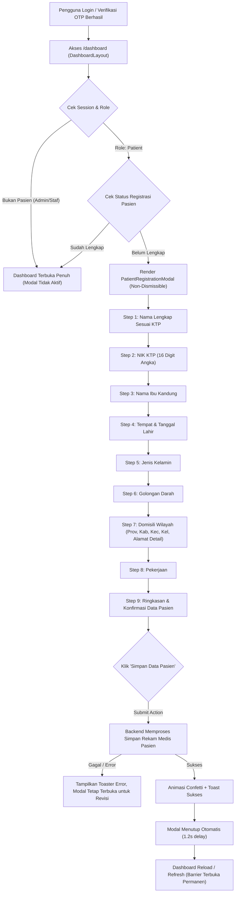

# Feature Requirement Manifest: Post-Authentication Mandatory Patient Registration Modal Barrier

> **Dokumen Resmi Kebutuhan Fitur (Frontend to Backend Delegation Manifest)**  
> **Modul:** `data-pasien` / `patient-onboarding`  
> **Target Audiens:** Backend Engineer / Backend Agent  
> **Sumber Analisis:** Codebase Frontend Next.js (Traced & Evidence-Based)  
> **Status:** Siap untuk Penyusunan Kontrak API Backend  
> **Tanggal:** 19 September 2026

---

## 1. Feature

**Post-Authentication Mandatory Patient Registration / Onboarding Modal Barrier** (Modal Lengkapi Data Pasien Pertama Kali Login)

---

## 2. Objective

Memastikan setiap pengguna dengan peran pasien (`patient`) yang baru pertama kali masuk (_first-time login_) atau belum memiliki rekam medis terdaftar, diwajibkan melengkapi data identitas kependudukan dan demografi pasien secara lengkap sebelum diizinkan mengakses fitur dashboard klinik. Modal ini dirancang sebagai _blocking barrier_ non-dismissible yang tidak dapat ditutup, diabaikan, atau di-bypass hingga seluruh data tervalidasi dan berhasil disimpan di server.

---

## 3. User Flow



1. **Autentikasi:** Pasien masuk ke sistem melalui alur login atau verifikasi email/OTP.
2. **Evaluasi Layout Server:** Server Component `src/app/dashboard/layout.tsx` membaca session dan context registrasi pengguna.
3. **Pemicu Barrier:** Jika peran pengguna adalah pasien dan data registrasi rekam medis belum lengkap (`!registrationContext.isComplete`), `PatientRegistrationModal` dimuat dengan `isOpen={true}`, `showCloseButton={false}`, dan `dismissible={false}`. Pasien tidak bisa menutup modal dengan klik di luar backdrop atau tombol silang.
4. **Pengisian Bertahap (8 Input Steps):** Pasien mengisi data secara berurutan. Tombol _"lanjutkan"_ hanya aktif jika field pada langkah tersebut memenuhi skema validasi Zod.
5. **Peninjauan Akhir (Step 9):** Pasien memeriksa rangkuman data di komponen `PatientRegistrationSummary`.
6. **Pengiriman & Penyimpanan:** Pasien mengeklik _"simpan data pasien"_. Tombol berubah menjadi state loading dengan spinner.
7. **Respon & Penyelesaian:**
   - Jika berhasil, animasi confetti aktif, toaster sukses muncul, modal menutup otomatis, dan `router.refresh()` membuka akses dashboard secara permanen.
   - Jika gagal, modal tetap terbuka pada langkah ringkasan dengan notifikasi error dari server untuk perbaikan.

---

## 4. Frontend Entry Points

| Elemen                       | Lokasi File                                                                         | Tipe             | Peran dalam Alur                                                                    |
| :--------------------------- | :---------------------------------------------------------------------------------- | :--------------- | :---------------------------------------------------------------------------------- |
| **Dashboard Layout**         | `src/app/dashboard/layout.tsx`                                                      | Server Component | Gatekeeper yang memeriksa kelengkapan profil dan merender modal jika belum lengkap. |
| **Registration Route Guard** | `src/app/patient-registration/page.tsx`                                             | Page Route       | Rute direct fallback yang mengarahkan user kembali ke dashboard mount barrier.      |
| **Modal Wrapper Barrier**    | `src/features/data-pasien/components/registration/patient-registration-modal.tsx`   | Client Component | Modal non-dismissible dengan animasi GSAP dan multi-step stepper.                   |
| **Form Controller Hook**     | `src/features/data-pasien/components/registration/use-patient-registration-form.ts` | Custom Hook      | Mengelola TanStack Form state, validasi bertahap, dan eksekusi Server Action.       |
| **Step Fields Renderer**     | `src/features/data-pasien/components/registration/patient-registration-fields.tsx`  | Component        | Merender field interaktif untuk Step 1 sampai Step 9.                               |
| **Server Action**            | `src/features/data-pasien/api/patient-registration-actions.ts`                      | Server Action    | Titik dispatch `completePatientRegistrationAction` dari UI ke service layer.        |
| **Registration Service**     | `src/features/data-pasien/api/patient-registration-service.ts`                      | Server Service   | Logika orkestrasi pembuatan record dan penandaan status selesai.                    |

---

## 5. Inputs Inventory

Seluruh input form ini didefinisikan secara resmi pada skema `src/features/data-pasien/schemas/patient-registration-schema.ts`:

| Field              | Purpose                                                 | Required? | Frontend Rule                                                | Source                                                  | Transformation                                                       |
| :----------------- | :------------------------------------------------------ | :-------: | :----------------------------------------------------------- | :------------------------------------------------------ | :------------------------------------------------------------------- |
| `name`             | Nama lengkap pasien sesuai KTP / identitas resmi        |    Ya     | Minimal 3 karakter, string trim                              | Input teks (default: `user.name` dari session jika ada) | `trim()`                                                             |
| `nik`              | Nomor Induk Kependudukan (identifikasi rekam medis)     |    Ya     | Tepat 16 digit angka regex (`^\d{16}$`)                      | Input teks numerik                                      | Non-angka difilter (`replace(/\D/g, '')`), dipotong maks 16 karakter |
| `nama_ibu_kandung` | Nama ibu kandung pasien untuk verifikasi rekam medis    |    Ya     | Minimal 3 karakter, string trim                              | Input teks                                              | `trim()`                                                             |
| `tempat_lahir`     | Kota / tempat lahir pasien                              |    Ya     | Minimal 2 karakter, string trim                              | Input teks                                              | `trim()`                                                             |
| `birth_date`       | Tanggal lahir pasien                                    |    Ya     | Minimal 1 karakter, format tanggal valid                     | Custom date picker (Hari, Bulan, Tahun)                 | Dikonversi ke format ISO date `YYYY-MM-DD`                           |
| `gender`           | Jenis kelamin pasien                                    |    Ya     | Salah satu dari: `'Laki-laki'` atau `'Perempuan'`            | Pilihan kartu radio (`PatientGenderSelector`)           | Nilai enum persis                                                    |
| `blood_type`       | Golongan darah pasien                                   |    Ya     | Salah satu dari: `'A'`, `'B'`, `'AB'`, `'O'`, `'Belum Tahu'` | Pilihan kartu (`PatientBloodTypeSelector`)              | Nilai enum persis                                                    |
| `provinsi`         | Nama provinsi domisili                                  |    Ya     | Minimal 1 karakter                                           | Dropdown seleksi wilayah                                | Nama label provinsi                                                  |
| `provinsi_id`      | Kode identifikasi provinsi                              |    Ya     | Minimal 1 karakter                                           | Nilai opsi provinsi yang dipilih                        | Kode ID wilayah                                                      |
| `kabupaten`        | Nama kota atau kabupaten domisili                       |    Ya     | Minimal 1 karakter                                           | Dropdown seleksi bertingkat (bergantung provinsi)       | Nama label kabupaten                                                 |
| `kabupaten_id`     | Kode identifikasi kabupaten                             |    Ya     | Minimal 1 karakter                                           | Nilai opsi kabupaten yang dipilih                       | Kode ID wilayah                                                      |
| `kecamatan`        | Nama kecamatan domisili                                 |    Ya     | Minimal 1 karakter                                           | Dropdown seleksi bertingkat (bergantung kabupaten)      | Nama label kecamatan                                                 |
| `kecamatan_id`     | Kode identifikasi kecamatan                             |    Ya     | Minimal 1 karakter                                           | Nilai opsi kecamatan yang dipilih                       | Kode ID wilayah                                                      |
| `kelurahan`        | Nama kelurahan atau desa domisili                       |    Ya     | Minimal 1 karakter                                           | Dropdown seleksi bertingkat (bergantung kecamatan)      | Nama label kelurahan                                                 |
| `kelurahan_id`     | Kode identifikasi kelurahan/desa                        |    Ya     | Minimal 1 karakter                                           | Nilai opsi kelurahan yang dipilih                       | Kode ID wilayah                                                      |
| `alamat_detail`    | Alamat detail (nama jalan, RT/RW, nomor rumah/bangunan) |    Ya     | Minimal 5 karakter, string trim                              | Input teks                                              | `trim()`                                                             |
| `pekerjaan`        | Pekerjaan atau profesi pasien saat ini                  |    Ya     | Minimal 2 karakter, string trim                              | Input teks                                              | `trim()`                                                             |

---

## 6. Frontend Validation

- **Validasi Bertahap (_Step-by-Step_):**  
  Pada `patient-registration-schema.ts`, frontend menerapkan `patientRegistrationStepSchemas` menggunakan `.pick()` dari skema induk. Pasien tidak dapat berpindah ke langkah berikutnya (`handleProceed`) apabila step validator mengembalikan error:
  - Step 1 memvalidasi `name`
  - Step 2 memvalidasi `nik`
  - Step 3 memvalidasi `nama_ibu_kandung`
  - Step 4 memvalidasi `tempat_lahir` dan `birth_date`
  - Step 5 memvalidasi `gender`
  - Step 6 memvalidasi `blood_type`
  - Step 7 memvalidasi seluruh hirarki wilayah dan `alamat_detail`
  - Step 8 memvalidasi `pekerjaan`
  - Step 9 memvalidasi skema utuh sebelum submit
- **Batasan Format Input:**
  - Field NIK memiliki input filter real-time yang membuang karakter non-digit dan mengunci batas pada 16 karakter.
  - Field tanggal lahir memvalidasi usia kalkulatif dan batas tahun kabisat / jumlah hari tiap bulan.
- **Peran Validasi:** Validasi di sisi frontend berfungsi untuk memandu UX agar pengguna tidak mengirimkan data yang tidak lengkap. Backend tetap menjadi pemilik otoritas validasi integritas data (misal: validasi keaslian NIK, pencegahan NIK ganda di database).

---

## 7. Derived Values

Nilai yang ditransformasikan atau diturunkan oleh frontend pada `registration-mapper.ts`:

1. **`domisili` (Alamat Gabungan):**
   - _Sumber:_ Gabungan dari `alamat_detail`, `kelurahan`, `kecamatan`, `kabupaten`, dan `provinsi`.
   - _Formula:_ `"${alamat_detail}, Kel. ${kelurahan}, Kec. ${kecamatan}, ${kabupaten}, Prov. ${provinsi}"`
   - _Tujuan:_ Keperluan pencetakan resep dan surat rujukan.
2. **`age` (Usia Pasien):**
   - _Sumber:_ Dihitung dari perbandingan antara `birth_date` dan tanggal saat ini (`now`) pada zona waktu `Asia/Jakarta`.
   - _Tujuan:_ Tampilan instan pada rekam medis dan konsultasi dokter.
3. **`patient_id` / Nomor Rekam Medis (_Medical Record Number_):**
   - _Sumber:_ Saat ini di-generate sementara di frontend/service mock dengan pola `RM-${year}-${paddedSequence}`.
   - _Catatan Kritis:_ Pembentukan Nomor Rekam Medis (No. RM) resmi harus menjadi kapabilitas backend yang terpusat dan berurutan secara atomik.

---

## 8. Data Dependencies

1. **Sesi Pengguna Terotentikasi:**
   - Frontend membutuhkan `userId`, `email`, dan `name` (opsional `image`) dari user yang sedang login untuk mengasosiasikan data pasien dengan akun otentikasi.
2. **Master Data Wilayah Indonesia (Administratif):**
   - Input domisili membutuhkan daftar Provinsi, Kabupaten/Kota, Kecamatan, dan Kelurahan/Desa.
   - _Kondisi saat ini di frontend:_ Menggunakan konstanta lokal statis `PATIENT_REGISTRATION_REGIONS`.

---

## 9. Read Capabilities Required (Kebutuhan Akses Data dari Backend)

1. **Kapabilitas Pengecekan Status Kelengkapan Registrasi Pasien:**
   - Frontend perlu mengetahui apakah akun pengguna yang sedang login (`currentUser`) sudah memiliki profil pasien yang lengkap atau belum.
   - _Tujuan:_ Menentukan apakah modal registrasi wajib dimunculkan atau disembunyikan saat `DashboardLayout` di-render di sisi server.
2. **Kapabilitas Mengambil Data Profil Pasien Eksisting:**
   - Frontend perlu membaca profil pasien (nama lengkap, NIK, jenis kelamin, tanggal lahir, nomor rekam medis) yang terikat dengan user ID saat ini jika user mengakses dashboard.

---

## 10. Write / Action Capabilities Required (Kebutuhan Aksi ke Backend)

1. **Kapabilitas Menyimpan Data Registrasi Pasien Pertama Kali:**
   - Backend perlu menerima payload data profil lengkap pasien yang dikirimkan saat pasien menyelesaikan 9 langkah pada modal.
   - Backend perlu mengaitkan profil pasien baru tersebut dengan akun pengguna yang sedang login (`userId`).
2. **Kapabilitas Mengunci / Menandai Profil Selesai Secara Permanen:**
   - Begitu registrasi berhasil disimpan, backend harus memastikan status pasien menjadi aktif dan tercatat lengkap di basis data (bukan sekadar cookie browser).
   - Pada pemanggilan `GET /api/v1/auth/me` atau sesi berikutnya, objek `patient` pada entitas `User` harus sudah terisi (`not null`).

---

## 11. UI States

| UI State                         | Pemicu (Trigger)                                         | Perilaku Frontend (UI Behavior)                                                                                                     | Kebutuhan Informasi dari Backend         |
| :------------------------------- | :------------------------------------------------------- | :---------------------------------------------------------------------------------------------------------------------------------- | :--------------------------------------- |
| **Unauthenticated**              | Cookie auth tidak ada / kedaluwarsa                      | Dialihkan (_redirect_) ke `/auth/sign-in`.                                                                                          | Status sesi otentikasi                   |
| **Bukan Pasien (Admin/Staf)**    | Role user adalah `'ADMIN'` atau `'STAF'`                 | Modal registrasi tidak dirender, dashboard admin/staf terbuka penuh.                                                                | Field role pada user DTO                 |
| **Pasien Belum Registrasi**      | Role pasien, status profil rekam medis belum ada/lengkap | Modal registrasi muncul menutupi layar, tombol tutup ditiadakan (_modal barrier_).                                                  | Konfirmasi bahwa profil pasien kosong    |
| **Navigasi Step (1–8)**          | Pengguna mengisi input pada step aktif                   | Indikator step menyala, validasi Zod dievaluasi per step. Tombol _"lanjutkan"_ aktif jika valid.                                    | Tidak ada (lokal state)                  |
| **Review / Konfirmasi (Step 9)** | Pengguna mencapai step terakhir                          | Rangkuman seluruh data ditampilkan. Tombol menjadi _"simpan data pasien"_.                                                          | Tidak ada (lokal state)                  |
| **Submitting**                   | Pengguna menekan tombol simpan                           | Tombol disabled, animasi spinner muncul, input terkunci.                                                                            | Proses mutasi backend berlangsung        |
| **Submit Success**               | Server Action mengembalikan `success: true`              | Efek confetti meletus, toast _"🎉 horeee! data pasien berhasil disimpan!"_, delay 1.2 detik, modal menutup, dan `router.refresh()`. | Konfirmasi sukses & ID rekam medis       |
| **Submit Error**                 | Backend mengembalikan error / validasi gagal             | Modal tetap terbuka pada step review, toast menampilkan pesan error, tombol simpan aktif kembali.                                   | Pesan kegagalan yang dapat dipahami user |

---

## 12. Error Requirements

Frontend perlu membedakan kondisi kegagalan berikut untuk menyajikan umpan balik yang akurat:

1. **Sesi Berakhir / Tidak Valid:** Sesi login pengguna habis saat sedang mengisi modal ➔ Frontend mengarahkan pengguna kembali ke login.
2. **Validasi Gagal di Server:** Data input yang dikirim ditolak oleh validasi server (misal format NIK tidak sesuai standar kependudukan) ➔ Pesan spesifik ditampilkan ke pengguna.
3. **Konflik Data Kependudukan (Conflict / Duplicate NIK):** NIK yang dimasukkan sudah pernah terdaftar pada rekam medis pasien lain di klinik ➔ Frontend memerlukan indikasi pesan bahwa NIK telah terdaftar.
4. **Kesalahan Internal Server:** Terjadi gangguan jaringan atau server ➔ Pesan error generik agar pengguna dapat mencoba submit ulang.

---

## 13. Authentication & Authorization Dependency

- **Wajib Terotentikasi:** Fitur ini hanya berjalan di dalam area yang dilindungi autentikasi (`/dashboard/*`).
- **Keterikatan Role Pasien:** Modal registrasi ini secara spesifik hanya ditujukan untuk pengguna dengan peran sistem `PATIENT` (atau `role: 'patient'`). Pengguna staf atau admin tidak boleh disajikan modal registrasi pasien ini.
- **Keamanan Mutasi:** Server Action `completePatientRegistrationAction` mengekstrak `userId` langsung dari session server / cookie terenkripsi, bukan dari payload kiriman klien, untuk mencegah manipulasi ID akun.

---

## 14. Existing Backend Dependencies & Kesenjangan (_Gaps_)

Berdasarkan penelusuran pada kode saat ini:

1. **Kontrak yang Sudah Ada di Frontend:**
   - `authenticatedUserDtoSchema` pada endpoint `GET /api/v1/auth/me` sudah memiliki properti:
     ```typescript
     patient: patientProfileDtoSchema.nullable().optional();
     ```
     dengan tipe `PatientProfileDto`.
2. **Kesenjangan Saat Ini (Handoff Need):**
   - Di `patient-registration-service.ts`, pengecekan kelengkapan saat ini masih mengandalkan cookie klien sementara:
     ```typescript
     const completionCookie = cookieStore.get(PATIENT_REGISTRATION_COMPLETED_COOKIE)?.value ?? null;
     ```
   - Fungsi simpan pasien `createPatient` masih menyimpan data ke memori lokal frontend (`const patientRecords: Patient[] = [];`).
   - Belum ada endpoint API resmi di backend (seperti `POST /api/v1/patients/registration` atau sejenisnya) yang dipanggil untuk persistensi data pasien ke PostgreSQL dan mengaitkannya dengan akun `User`.

---

## 15. Backend Request (Capability-Level Request)

Frontend membutuhkan kapabilitas backend berikut:

1. **Dukungan Evaluasi Status Profil Pasien pada Sesi Auth:**
   - Backend diharapkan memastikan respon `GET /api/v1/auth/me` (atau session endpoint) menyertakan objek `patient: PatientProfile | null`.
   - Jika user pasien baru belum mengisi data, objek `patient` bernilai `null` sehingga frontend dapat mendeteksi `isComplete = false`.
   - Setelah registrasi selesai, objek `patient` terisi sehingga `isComplete = true` dan modal tidak pernah muncul lagi.
2. **Dukungan Penyimpanan Profil Pasien Baru Terkait Akun Pengguna:**
   - Backend mampu menerima dan memvalidasi data demografi pasien yang dikumpulkan form (Nama, NIK, Nama Ibu Kandung, Tempat/Tanggal Lahir, Gender, Golongan Darah, Domisili lengkap, Pekerjaan).
   - Backend mengaitkan profil pasien tersebut dengan entitas `users` yang bersangkutan di PostgreSQL.
   - Backend mengalokasikan Nomor Rekam Medis (_Medical Record Number_) resmi secara atomik.
3. **Pembedaan Respon Konflik Identitas:**
   - Backend diharapkan memberikan respon kegagalan yang dapat dibedakan jika terjadi duplikasi NIK atau data kependudukan yang tidak valid.

---

## 16. Open Questions

1. **Sumber Master Data Wilayah:** Apakah dropdown bertingkat untuk wilayah (Provinsi, Kota/Kabupaten, Kecamatan, Kelurahan) nantinya akan disediakan melalui endpoint referensi data backend (misal integrasi master data wilayah / SatuSehat), atau frontend diizinkan tetap menggunakan daftar statis?
2. **Skema Identifikasi Pasien:** Apakah backend mewajibkan field kontak darurat (_emergency contact_) atau alergi pada tahap registrasi pertama ini, ataukah cukup 8 kelompok data yang ada saat ini?

---

## 17. Evidence

- `src/app/dashboard/layout.tsx` (baris 86–128) — Pengecekan layout server dan rendering kondisional `PatientRegistrationModal` sebagai blocking barrier.
- `src/features/data-pasien/components/registration/patient-registration-modal.tsx` (baris 129–136) — ModalWrapper dengan konfigurasi `dismissible={false}`, `showCloseButton={false}`, `onClose={() => undefined}`.
- `src/features/data-pasien/schemas/patient-registration-schema.ts` — Definisi skema Zod untuk 8 input step dan validasi komplit.
- `src/features/data-pasien/constants/registration-options.ts` (baris 29–66) — Metadata 8 langkah input dan 1 langkah peninjauan.
- `src/features/data-pasien/components/registration/use-patient-registration-form.ts` — Pengendali form TanStack dan pemanggilan Server Action.
- `src/features/data-pasien/components/registration/patient-registration-fields.tsx` — Implementasi komponen input dan dropdown wilayah per step.
- `src/features/data-pasien/components/registration/patient-registration-summary.tsx` — Rangkuman data pada step 9.
- `src/features/data-pasien/api/patient-registration-actions.ts` — Server Action `completePatientRegistrationAction`.
- `src/features/data-pasien/api/patient-registration-service.ts` — Context registrasi pasien dan dependensi status.
- `src/server/contracts/auth/auth.dto.ts` (baris 17–29) — Definisi DTO profil pasien eksisting di backend.

---

## 18. Traceability Matrix

| Kebutuhan Fitur                                | Bukti di Frontend                                                                 | Alur Pengguna                                                                                       | Kapabilitas Backend yang Dibutuhkan                                                                                          | Status                                                               |
| :--------------------------------------------- | :-------------------------------------------------------------------------------- | :-------------------------------------------------------------------------------------------------- | :--------------------------------------------------------------------------------------------------------------------------- | :------------------------------------------------------------------- |
| **Blocking Modal Barrier saat Login Pertama**  | `dashboard/layout.tsx:123-128`, `patient-registration-modal.tsx:129-136`          | Pasien login ➔ Dashboard layout mendeteksi profil kosong ➔ Modal non-dismissible menutupi dashboard | Backend menyediakan status profil pasien (`patient: null` vs `patient: PatientProfile`) pada session auth                    | **Missing Backend Persistence** (Saat ini masih memakai cookie mock) |
| **Pencegahan Akses Sebelum Registrasi**        | `patient-registration-modal.tsx:131-133`                                          | Pasien tidak bisa menutup modal dengan klik luar atau ESC                                           | Menjaga integritas data pengguna di mana pasien tanpa rekam medis tidak boleh membuat appointment                            | **Observed in Frontend**                                             |
| **Pengumpulan Data Identitas Pasien (8 Step)** | `patient-registration-schema.ts:3-28`, `patient-registration-fields.tsx`          | Pasien memasukkan nama, NIK, nama ibu, TTL, gender, gol darah, domisili, pekerjaan                  | Backend mampu menerima dan memvalidasi dataset kependudukan pasien                                                           | **Need Backend API Implementation**                                  |
| **Penyimpanan Data & Pembentukan No. RM**      | `patient-registration-actions.ts:17-59`, `registration-mapper.ts:59-99`           | Pasien klik simpan data pada step review ➔ Data terkirim ke server                                  | Backend menyimpan data ke tabel `patients`, men-generate Nomor Rekam Medis (No. RM), dan mengaitkannya ke `userId`           | **Need Backend API Implementation**                                  |
| **Penghapusan Barrier Setelah Sukses**         | `patient-registration-modal.tsx:38-47`, `patient-registration-service.ts:133-146` | Submit berhasil ➔ Modal menutup ➔ Refresh halaman ➔ Dashboard terbuka penuh                         | Setelah sukses simpan, pemanggilan sesi auth berikutnya mengembalikan profil pasien terisi sehingga barrier tidak aktif lagi | **Need Backend API Implementation**                                  |

---

## 19. Contract Boundary

The frontend report describes frontend requirements and dependencies. The final API contract, endpoint design, transport details, backend validation semantics, response schema, error taxonomy, authorization model, and implementation remain backend-owned unless already established by an existing contract.
