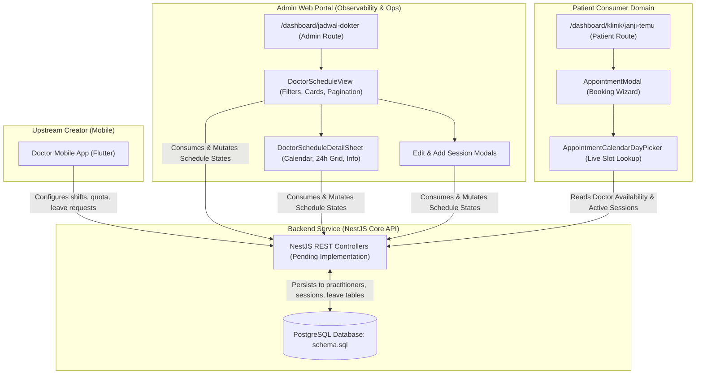

# Doctor Schedule Management — Cross-Platform Capability Audit & Backend Contract Specification

> **Document Type:** Feature Requirement Manifest & Backend Contract Handoff  
> **Module Affiliation:** `jadwal-dokter` (Admin Management Domain) & `klinik` / `janji-temu` (Patient Consumer Domain)  
> **Author:** Senior Frontend Requirement Tracer / Architect  
> **Target Audience:** Backend Engineering Team (NestJS Core API) & Frontend Implementation Team  
> **Status:** Final & Implementation-Ready (Ready for Backend Handoff)  
> **Base Version:** v1.0.0  
> **Verification Standard:** Strict Evidence-First, Zero Artificial Data, Anti-Hallucination Verified

---

## 1. Executive Summary

This specification establishes the authoritative cross-platform capability audit, frontend requirement manifest, and backend contract specification for **Doctor Schedule Management ("Jadwal Dokter")**.

### 1.1 Business Architecture & System Boundaries

1. **Upstream Source of Truth (Doctor Mobile App):**
   Internal clinic doctors use their dedicated mobile application (Flutter) to configure practice availability, weekly recurring schedules, daily clinical sessions, and submit operational leave requests. The mobile app is the **upstream creator** of schedule data. Without doctor input, no schedules exist.
2. **Observability & Management Portal (Admin Web Client):**
   Located at `/dashboard/jadwal-dokter`, internal clinic administrative staff and medical directors use the web application to observe, inspect, monitor, and administratively manage doctor schedules across all polyclinics. Admin capabilities are focused on operational supervision: viewing real-time availability, inspecting 24-hour daily session grids, checking leave status, executing emergency overrides (e.g. marking a doctor on leave or closing practice for the day), and exporting CSV reports.
3. **Downstream Consumer (Patient Web & Mobile Portal):**
   Located at `/dashboard/klinik/janji-temu`, registered clinic patients query doctor availability when booking appointments via the interactive calendar (`AppointmentCalendarDayPicker`). The patient booking workflow directly depends on doctor schedule data to disable leave dates, indicate booked-out dates, and provide valid session time slots.
4. **Explicit Business Constraint (Removal of "Add Doctor"):**
   The Admin Doctor Schedule interface is strictly an operational schedule management view. It **must not contain an "Add Doctor" ("Tambah Dokter") action**. Doctor onboarding, credentialing (STR/SIP), and profile creation belong to human resources and practitioner registry workflows (`staff_profiles`, `staff_credentials`, `practitioners`), completely separated from daily schedule operations.

### 1.2 Audit Findings & Technical Gap

- **Backend Contract Implemented:** The backend now exposes the doctor schedule contract through `/api/v1/admin/doctor-schedules`, `/api/v1/admin/doctor-schedules/:id`, `/api/v1/clinical/practitioners`, and the mobile upstream schedule endpoints under `/api/v1/schedules`.
- **Frontend Mock Fragmentation Removed for Admin Schedule:** The admin doctor schedule list and detail sheet now read backend contracts. Legacy static mock files have been removed from the active source tree.
- **Database Schema Readiness:** The PostgreSQL foundation in `docs/database/schema.sql` already provides normalized tables (`practitioners`, `staff_profiles`, `practitioner_availability`, `practitioner_schedule_day_settings`, `staff_leave_requests`, `practitioner_leave_periods`, `practitioner_schedule_sessions`, `appointments`, `queue_tickets`). No disruptive database migrations are needed; the gap lies entirely in **missing backend service queries, aggregation read models, and REST controller endpoints**.

---

## 2. Verified Existing Architecture and Data Flow

### 2.1 Repository Architecture Overview

The frontend repository `fadhiilahahmadzikri/Amanah-healthcare` is an enterprise Next.js 16 (App Router) application built on React 19, TypeScript 5.7, Tailwind CSS v4, shadcn/ui primitives, and TanStack React Query v5.



### 2.2 Security & Route Access Guardrails

Evidence from `src/lib/rbac/route-manifest.ts` and `src/lib/guard.ts`:

- `/dashboard/jadwal-dokter`: Protected route, `allowedRoles: ['admin']`, guarded by `requireAdmin()`. Non-admin users are rejected and redirected to `/dashboard/klinik/antrean`.
- `/dashboard/klinik/janji-temu`: Protected route, `allowedRoles: ['patient']`, guarded by `requirePatient()`. Admin users are redirected to `/dashboard/admin`.
- Transport Layer: All server-side requests route through `src/server/http/http-client.ts`, which enforces session authentication, timeout policies (`timeout.policy.ts`), idempotent retries (`retry.policy.ts`), and strict Zod runtime contract validation.

---

## 3. Mobile Schedule Creation Workflow (Upstream Integration)

The mobile application acts as the upstream provider. Understanding this workflow ensures the Admin web portal does not introduce contradictory abstractions:

1. **Doctor Authentication:** Doctor logs in using verified credentials linked to `users` and `staff_profiles` where `staff_type = 'doctor'` and `practitioners` identity exists.
2. **Recurring Availability Setup:** The doctor defines regular practice rules in `practitioner_availability` specifying `day_of_week` (0=Sunday to 6=Saturday), `start_time`, `end_time`, and baseline `capacity`.
3. **Daily Schedule & Session Generation:**
   - The backend or doctor creates concrete date settings in `practitioner_schedule_day_settings` (`schedule_date`, `target_quota`, `is_leave`).
   - Specific clinical sessions are created in `practitioner_schedule_sessions` (`session_shift`, `start_time`, `end_time`, `capacity`, `available_slots`, `room_id`).
   - Supported shift types mapped to `staff_shift`:
     - `morning` ("Sesi Pagi": 06:00 – 12:00)
     - `afternoon` ("Sesi Siang / Sore": 12:00 – 18:00)
     - `night` ("Sesi Malam": 18:00 – 24:00)
     - `early_morning` ("Shift Dini Hari": 00:00 – 06:00)
4. **Leave & Absence Workflow:**
   - When a doctor requires time off, they submit a request to `staff_leave_requests` (`request_type`, `start_date`, `end_date`, `reason`, optional `substitute_practitioner_id`).
   - Upon administrative or medical director approval, the backend creates an entry in `practitioner_leave_periods` and marks `practitioner_schedule_day_settings.is_leave = true`.
   - Affected sessions in `practitioner_schedule_sessions` have their status updated to `'leave'`, with `available_slots` set to `0`.

---

## 4. Admin Doctor Schedule UI/UX Audit

### 4.1 Page-Level Analysis (`src/app/dashboard/jadwal-dokter/page.tsx`)

- **Route Path:** `/dashboard/jadwal-dokter`
- **Page Container:** `PageContainer` with `scrollable={false}`, `pageTitle="Jadwal Dokter"`, `pageDescription="Kelola jadwal praktik dokter, atur ketersediaan dan slot pasien."`
- **Role Requirement:** Admin only (`await requireAdmin()`).
- **Data Prefetching:** `DoctorScheduleListingPage` reads URL query parameters via `nuqs` (`searchParamsCache`) and invokes `queryClient.prefetchQuery(doctorScheduleQueryOptions(filters))` wrapped in `HydrationBoundary`.
- **Active Layout Structure:**
  1. **Top Toolbar:** Search input, Month filter, Date filter, Poli filter, Status filter, Reset filter button, CSV Export button (`DoctorExportButton`).
  2. **Grid Container:** Responsive card grid (1 col on mobile, 2 cols on md, 3 cols on xl) inside a vertical `ScrollArea`.
  3. **Floating Pagination Bar:** Detached glassmorphism bar pinned to the bottom displaying total doctors registered, cards per page selector (6, 12, 18, 24, 30), and pagination buttons.

### 4.2 State Handling

- **Initial / Loading State:** `DoctorScheduleCardsSkeleton` renders pulse cards (`h-[340px] rounded-[24px]`).
- **Empty State:** `EmptyState` component with calendar icon, clear feedback, and "Reset Filter" button when active filters yield zero records.
- **Error State:** Currently managed via `sonner` toasts and React Query boundary.

---

## 5. Complete Card-Level Data Inventory

Inspected directly from `src/features/jadwal-dokter/components/doctor-schedule-card.tsx`:

| UI Field / Element    | Label Rendered            | Data Type              | Example Value                              | Source / Derivation                                                | Mandatory | Nullable |        Admin Editable         | Backend Dependency / Entity                |
| :-------------------- | :------------------------ | :--------------------- | :----------------------------------------- | :----------------------------------------------------------------- | :-------: | :------: | :---------------------------: | :----------------------------------------- |
| **Doctor Avatar**     | Doctor Image              | `string` (URI)         | `/assets/avatar/docter/woman-docter-1.png` | `staff_profiles.avatar_url` or `users.image_url`                   |    No     |   Yes    |        No (Read-only)         | `staff_profiles.avatar_url`                |
| **Status Badge**      | `Buka` / `Penuh` / `Cuti` | `enum`                 | `'Buka'`                                   | Computed from `is_cuti`, `slot_tersedia`, and session statuses     |    Yes    |    No    | Yes (via Cuti/Schedule Modal) | Read model computation / `schedule_status` |
| **Phone Action**      | Quick Phone Button        | `string` (tel)         | `'0812 3456 7890'`                         | `staff_profiles.phone`                                             |    No     |   Yes    |    No (Phone call trigger)    | `staff_profiles.phone`                     |
| **Medical Specialty** | Specialty Badge           | `string`               | `'Penyakit Dalam'`                         | `medical_specialties.name`                                         |    Yes    |    No    |       No (Master data)        | `medical_specialties.name`                 |
| **Doctor Name**       | Heading H3                | `string`               | `'dr. Sarah Putri, Sp.PD'`                 | `practitioners.display_name`                                       |    Yes    |    No    |      No (Staff profile)       | `practitioners.display_name`               |
| **Practice Room**     | Room Row                  | `string`               | `'Poli Penyakit Dalam, Room 201'`          | `clinic_rooms.name` + `location`                                   |    Yes    |   Yes    |     Yes (Room assignment)     | `clinic_rooms.name`                        |
| **Practice Date**     | Calendar Row              | `string`               | `'Selasa, 20 Mei 2026'`                    | Formatted local date string                                        |    No     |   Yes    |        No (Contextual)        | `schedule_date`                            |
| **Today's Hours**     | `Jadwal Praktik`          | `string`               | `'09.00 – 09.30'` or `'07:30 - 11:30'`     | Derived from upcoming/active session time                          |    Yes    |    No    |     Yes (via Edit Modal)      | `practitioner_schedule_sessions`           |
| **Available Slots**   | `Slot Tersedia`           | `number`               | `18`                                       | Sum of `available_slots` across active daily sessions              |    Yes    |    No    |     Yes (via Edit Modal)      | Computed: `SUM(sessions.available_slots)`  |
| **Total Capacity**    | `Kapasitas Harian`        | `number`               | `30`                                       | Sum of `capacity` across active daily sessions                     |    Yes    |    No    |     Yes (via Edit Modal)      | Computed: `SUM(sessions.capacity)`         |
| **Cuti Notice**       | `Dokter sedang cuti`      | `string`               | `'Cuti Tahunan'`                           | `practitioner_leave_periods.reason` or `day_settings.leave_reason` |    No     |   Yes    |     Yes (via Cuti toggle)     | `practitioner_leave_periods`               |
| **Daily Sessions**    | Multi-session metadata    | `DoctorDailySession[]` | `[{ nama_sesi: 'Sesi Pagi', ... }]`        | Associated daily sessions array                                    |    Yes    |    No    |    Yes (Add/Edit sessions)    | `practitioner_schedule_sessions`           |
| **Reschedule Action** | `Reschedule` Button       | Action Trigger         | N/A                                        | Opens `DoctorScheduleEditModal`                                    |    Yes    |    No    |              Yes              | Mutation trigger                           |
| **Detail Action**     | `Detail` Button           | Action Trigger         | N/A                                        | Opens `DoctorScheduleDetailSheet`                                  |    Yes    |    No    |              N/A              | Detail fetch trigger                       |

---

## 6. Expanded Detail and Interaction Analysis

When an Admin clicks **"Detail"**, `DoctorScheduleDetailSheet` (`src/features/jadwal-dokter/components/doctor-schedule-detail-sheet.tsx`) opens as a slide-over sheet:

### 6.1 Top Header & Profile Strip

- **Avatar & Verified Badge:** Verified icon badge and status indicator dot (Emerald = Buka, Amber = Penuh, Sky Blue = Cuti).
- **Name & Professional Title:** `practitioners.display_name` with gradient specialty pill.
- **Handle & Location:** Generates `@doctor_handle` from name and displays polyclinic room name.
- **Header Action Button:** "Atur Jadwal" button triggers `DoctorScheduleEditModal`.

### 6.2 Tab 1: "Kalender" (`DoctorTimelineCalendar.tsx`)

- **Monthly Matrix (7 Columns):** Renders the selected month (Mon–Sun).
- **Date State Representation:**
  - Past dates are automatically disabled (`opacity-35 cursor-not-allowed`).
  - Active/future dates display their status pill: **Buka (Green)**, **Penuh (Amber)**, **Cuti (Sky Blue)**.
- **Interactive Day Status Override:** Admins can click any active day to open a dropdown menu and switch day status between `Buka`, `Penuh`, and `Cuti`.
- **Navigation Shortcut:** A diagonal arrow icon (`↗`) on each day cell transitions directly to Tab 2 ("Jadwal & Kuota") for that specific date.
- **Collapsible Leave Banner:** If the doctor is on leave on the selected date, an accordion titled _"Lihat kenapa dokter ini cuti"_ expands to show the verified leave reason, date interval, and avatar.

### 6.3 Tab 2: "Jadwal & Kuota" (`DoctorDailyHourlyGrid.tsx`)

- **24-Hour POV Shift Segmentation:** Segmented into 4 clinical periods:
  1. _Pagi_ (06:00 – 12:00) — hours 06:00 to 11:00
  2. _Siang / Sore_ (12:00 – 18:00) — hours 12:00 to 17:00
  3. _Malam_ (18:00 – 24:00) — hours 18:00 to 23:00
  4. _Dini Hari_ (00:00 – 06:00) — hours 00:00 to 05:00
- **Hourly Cell Interaction:** Each hour cell displays its status and time. Clicking an hour opens a dropdown menu allowing Admins to set that hour to `buka`, `penuh`, or `tutup`.
- **Add Session Trigger:** Clicking _"Tambah jadwal"_ opens `DoctorAddSessionModal` allowing the Admin to append a session (Pagi, Siang, Malam, Dini Hari, or Custom) with designated quota and time boundaries.

### 6.4 Tab 3: "Info Dokter"

- Displays facility unit (`RS Amanah Healthcare`), medical specialty, email address, phone number, practice room, and overall staff status.

### 6.5 Secondary Interaction Modals

1. **`DoctorScheduleEditModal` (`doctor-schedule-edit-modal.tsx`):**
   - Allows setting/cancelling doctor-wide cuti status and entering leave reason.
   - Adjusts today's practice hours, overall schedule status (`Buka`, `Penuh`, `Cuti`), daily patient capacity, available slots, and practice room.
2. **`DoctorAddSessionModal` (`doctor-add-session-modal.tsx`):**
   - Inputs: Session Preset (`Sesi Pagi`, `Sesi Siang / Sore`, `Sesi Malam`, `Shift Dini Hari`, `Kustom`), Start Time (`jam_mulai`), End Time (`jam_selesai`), Patient Quota (`kuota_pasien`), Available Slots (`slot_tersedia`), and Session Status (`Buka`, `Penuh`, `Cuti`).

---

## 7. Admin Capability Matrix

| Operational Capability        | Business Purpose                                | Role Authorized | Access Type | Data Fields Handled                                       | Backend Endpoint Required                             |         Status in Codebase          |
| :---------------------------- | :---------------------------------------------- | :-------------- | :---------: | :-------------------------------------------------------- | :---------------------------------------------------- | :---------------------------------: |
| **Observe Doctor Schedules**  | Monitor clinic-wide doctor coverage             | `admin`         |  Read-only  | Doctor card metadata, sessions, availability              | `GET /api/v1/admin/doctor-schedules`                  | **Missing on Backend** (Uses mock)  |
| **Filter & Search Schedules** | Locate doctors by poli, date, month, status     | `admin`         |  Read-only  | Query params: `search`, `poli`, `status`, `date`, `month` | Query params on listing endpoint                      | **Frontend Ready, Backend Missing** |
| **Inspect Monthly Calendar**  | Audit monthly day-level availability            | `admin`         |  Read-only  | `monthly_schedule` array (day, date, status, notes)       | Part of schedule detail response                      | **Frontend Ready, Backend Missing** |
| **Inspect 24h Hourly Grid**   | Audit 24-hour shift coverage and capacity       | `admin`         |  Read-only  | Shift hours, session boundaries, slot stats               | Part of schedule detail response                      | **Frontend Ready, Backend Missing** |
| **Emergency Leave Override**  | Mark doctor on urgent leave / cuti              | `admin`         |  Mutative   | `is_cuti`, `cuti_reason`, `cuti_start`, `cuti_end`        | `PATCH /api/v1/admin/doctor-schedules/:id`            |    **Frontend Mutation Mocked**     |
| **Close Practice For Today**  | Close clinic practice due to emergency          | `admin`         |  Mutative   | `status_jadwal = 'Tutup'`, `slot_tersedia = 0`            | `PATCH /api/v1/admin/doctor-schedules/:id`            |    **Frontend Mutation Mocked**     |
| **Override Day Status**       | Adjust status of a specific calendar date       | `admin`         |  Mutative   | `day`, `status` (`'Buka' \| 'Penuh' \| 'Cuti'`)           | `PATCH /api/v1/admin/doctor-schedules/:id/days/:date` |    **Frontend Mutation Mocked**     |
| **Append Clinical Session**   | Add extra shift or surge clinic session         | `admin`         |  Mutative   | `nama_sesi`, `jam_mulai`, `jam_selesai`, `kuota`          | `POST /api/v1/admin/doctor-schedules/:id/sessions`    |    **Frontend Mutation Mocked**     |
| **Export Schedules to CSV**   | Operational reporting and administrative audits | `admin`         | Client/Read | Doctor names, specialties, rooms, hours, slots            | Client generation from server data                    |         **Frontend Ready**          |

---

## 8. Explicit Out-of-Scope Actions

### 8.1 Removal and Prohibition of "Tambah Dokter" ("Add Doctor")

- **Verified Business Rule:** The Doctor Schedule Management page **must not contain an "Add Doctor" action**.
- **Architectural Justification:** Doctor onboarding is an administrative credentialing process involving staff record creation (`staff_profiles`), professional credential verification (`staff_credentials`: STR, SIP, KKI), and clinical practitioner registration (`practitioners`). Embedding doctor creation into daily schedule supervision violates separation of concerns.
- **Implementation Status:** Verified that neither `src/app/dashboard/jadwal-dokter/page.tsx` nor `DoctorScheduleView` renders an "Add Doctor" button. Any legacy requirement, mock button, or proposed addition of "Tambah Dokter" on this page is **explicitly rejected and forbidden**.

### 8.2 Additional Out-of-Scope Capabilities

- **Patient Appointment Booking inside Schedule View:** Creating appointments for patients is out of scope for `/dashboard/jadwal-dokter`. Patient appointments are managed exclusively in `/dashboard/appointment-pasien` (for staff) and `/dashboard/klinik/janji-temu` (for patients).
- **Clinical Encounter / EMR Documentation:** Recording medical notes, diagnosis, and prescriptions belongs to `clinical_encounters` and medical records.
- **Staff Payroll & Wage Calculation:** Calculating shift pay or overtime based on schedule hours is out of scope.

---

## 9. Existing API and Backend Capability Audit

### 9.1 Verification of Backend Endpoints

Inspection of `src/server/api/endpoints.ts`, `src/server/api/paths.ts`, and `docs/ENDPOINT-MAP.md`:

- **Installed Endpoints:** Only Authentication (`AUTH_*`, `BETTER_AUTH_*`) and Patient Profile (`PATIENTS_*`) exist.
- **Doctor Schedule Endpoints:** **NONE.** No endpoint constants, paths, repository ports, or service commands exist for doctor schedules.

### 9.2 Verification of Frontend Service Layer

Inspection of `src/features/jadwal-dokter/api/service.ts`:

- Line 102 declares: `const doctorScheduleRecords: DoctorSchedule[] = [];`
- All queries (`getDoctorSchedules`, `getDoctorScheduleById`) read from this empty in-memory array.
- Mutations (`updateDoctorSchedule`, `updateDoctorDayStatus`) mutate this in-memory array and return mock responses.
- In `src/features/klinik/api/service.ts`: `getDoctors = () => []` and `getTimeSlots = () => []`.

### 9.3 Legacy Hardcoded Mock Data Removed

- `src/constants/mock-data/doctor-schedules.json`: Removed from the active source tree.
- `src/constants/mock-api-doctor-schedules.ts`: Removed from the active source tree.
- **Conclusion:** The admin doctor schedule UI is now expected to consume backend data only. Any remaining hardcoded schedule behavior should be treated as a regression.

---

## 10. Required API Contract Specification

To replace all mock data and establish a unified server-driven contract, the backend team must implement the following REST endpoints:

### 10.1 Endpoint: List Doctor Schedules (Admin View)

- **Method:** `GET`
- **Path:** `/api/v1/admin/doctor-schedules`
- **Purpose:** Retrieve paginated doctor schedules with polyclinic, status, and calendar date filtering for Admin supervision.
- **Authorization:** Bearer Session Token, Role: `admin`.

#### Query Parameters:

| Parameter | Type    | Required | Default | Description                                                         |
| :-------- | :------ | :------: | :-----: | :------------------------------------------------------------------ |
| `page`    | integer |    No    |   `1`   | Page number (1-indexed)                                             |
| `limit`   | integer |    No    |   `6`   | Records per page (6, 12, 18, 24, 30)                                |
| `search`  | string  |    No    |    —    | Search query against doctor name, specialty, or room                |
| `poli`    | string  |    No    |    —    | Comma-separated polyclinic/specialty names                          |
| `status`  | string  |    No    |    —    | Comma-separated status filters (`Buka`, `Penuh`, `Cuti`)            |
| `month`   | string  |    No    |    —    | Format `YYYY-MM` (e.g. `2026-09`) to resolve monthly calendar state |
| `date`    | string  |    No    |    —    | Format `YYYY-MM-DD` to evaluate schedule state for a specific date  |

#### Response Schema (`200 OK`):

```json
{
  "success": true,
  "data": {
    "doctors": [
      {
        "id": "doc-uuid-001",
        "practitioner_id": "prac-uuid-001",
        "nama_dokter": "dr. Sarah Putri, Sp.PD",
        "spesialisasi": "Penyakit Dalam",
        "status_dokter": "Buka",
        "email": "sarah.putri@amikomclinic.id",
        "nomor_telepon": "081234567890",
        "ruang_praktik": "Poli Penyakit Dalam, Room 201",
        "tanggal_praktik": "Selasa, 22 Sep 2026",
        "avatar": "https://images.unsplash.com/photo-1559839734-2b71ea197ec2?w=150",
        "slot_tersedia": 18,
        "kapasitas_per_hari": 30,
        "jadwal_hari_ini": "07:30 - 11:30",
        "status_jadwal": "Buka",
        "bulan_jadwal": "September 2026",
        "is_cuti": false,
        "cuti_reason": null,
        "cuti_start": null,
        "cuti_end": null,
        "sesi_harian": [
          {
            "id": "ses-uuid-101",
            "nama_sesi": "Sesi Pagi",
            "jam_mulai": "07:30",
            "jam_selesai": "11:30",
            "waktu": "07:30 - 11:30",
            "kuota_pasien": 15,
            "slot_tersedia": 8,
            "status_sesi": "Buka",
            "ruang": "Poli Penyakit Dalam, Room 201"
          },
          {
            "id": "ses-uuid-102",
            "nama_sesi": "Sesi Sore",
            "jam_mulai": "14:00",
            "jam_selesai": "17:30",
            "waktu": "14:00 - 17:30",
            "kuota_pasien": 15,
            "slot_tersedia": 10,
            "status_sesi": "Buka",
            "ruang": "Poli Penyakit Dalam, Room 201"
          }
        ]
      }
    ],
    "meta": {
      "page": 1,
      "limit": 6,
      "total_doctors": 14,
      "total_pages": 3
    }
  }
}
```

---

### 10.2 Endpoint: Get Doctor Schedule Detail (Monthly & 24h Grid)

- **Method:** `GET`
- **Path:** `/api/v1/admin/doctor-schedules/:id`
- **Purpose:** Retrieve full schedule details for a specific doctor, including the full monthly calendar matrix and 24-hour shift definitions.
- **Authorization:** Bearer Session Token, Role: `admin`.

#### Query Parameters:

| Parameter | Type    | Required |       Default        | Description               |
| :-------- | :------ | :------: | :------------------: | :------------------------ |
| `month`   | integer |    No    | Current month (0–11) | Calendar month index      |
| `year`    | integer |    No    |     Current year     | Calendar year (e.g. 2026) |

#### Response Schema (`200 OK`):

```json
{
  "success": true,
  "data": {
    "id": "doc-uuid-001",
    "practitioner_id": "prac-uuid-001",
    "nama_dokter": "dr. Sarah Putri, Sp.PD",
    "spesialisasi": "Penyakit Dalam",
    "status_dokter": "Buka",
    "email": "sarah.putri@amikomclinic.id",
    "nomor_telepon": "081234567890",
    "ruang_praktik": "Poli Penyakit Dalam, Room 201",
    "avatar": "https://images.unsplash.com/photo-1559839734-2b71ea197ec2?w=150",
    "slot_tersedia": 18,
    "kapasitas_per_hari": 30,
    "bulan_jadwal": "September 2026",
    "is_cuti": false,
    "cuti_reason": null,
    "cuti_start": null,
    "cuti_end": null,
    "monthly_schedule": [
      {
        "day": 1,
        "date": "2026-09-01",
        "status": "Buka",
        "notes": null
      },
      {
        "day": 2,
        "date": "2026-09-02",
        "status": "Penuh",
        "notes": "Slot terisi penuh oleh pasien reservasi"
      },
      {
        "day": 15,
        "date": "2026-09-15",
        "status": "Cuti",
        "notes": "Seminar Dokter Spesialis Penyakit Dalam"
      }
    ],
    "sesi_harian": [
      {
        "id": "ses-uuid-101",
        "nama_sesi": "Sesi Pagi",
        "jam_mulai": "07:30",
        "jam_selesai": "11:30",
        "waktu": "07:30 - 11:30",
        "kuota_pasien": 15,
        "slot_tersedia": 8,
        "status_sesi": "Buka",
        "ruang": "Poli Penyakit Dalam, Room 201"
      }
    ]
  }
}
```

---

### 10.3 Endpoint: Operational Schedule & Cuti Update

- **Method:** `PATCH`
- **Path:** `/api/v1/admin/doctor-schedules/:id`
- **Purpose:** Execute administrative schedule overrides, toggle cuti status, adjust capacity, or close practice.
- **Authorization:** Bearer Session Token, Role: `admin`.

#### Request Body Schema:

```json
{
  "is_cuti": true,
  "cuti_reason": "Cuti Tahunan & Pemulihan Operasi",
  "cuti_start": "2026-09-25",
  "cuti_end": "2026-09-30",
  "status_jadwal": "Cuti / Tutup",
  "slot_tersedia": 0,
  "kapasitas_per_hari": 30,
  "ruang_praktik": "Poli Penyakit Dalam, Room 201"
}
```

#### Response (`200 OK`):

Returns updated `DoctorSchedule` object with immediate invalidation tags.

---

### 10.4 Endpoint: Update Single Day Status

- **Method:** `PATCH`
- **Path:** `/api/v1/admin/doctor-schedules/:id/days/:date`
- **Purpose:** Update status for a specific date (e.g. `/days/2026-09-22`).
- **Authorization:** Bearer Session Token, Role: `admin`.

#### Request Body Schema:

```json
{
  "status": "Cuti",
  "notes": "Izin Dinas Luar Kota"
}
```

---

### 10.5 Endpoint: Append Clinical Session

- **Method:** `POST`
- **Path:** `/api/v1/admin/doctor-schedules/:id/sessions`
- **Purpose:** Append a new session shift for surge demand.
- **Authorization:** Bearer Session Token, Role: `admin`.

#### Request Body Schema:

```json
{
  "schedule_date": "2026-09-22",
  "nama_sesi": "Sesi Malam",
  "jam_mulai": "19:00",
  "jam_selesai": "22:00",
  "kuota_pasien": 10,
  "slot_tersedia": 10,
  "status_sesi": "Buka",
  "ruang": "Poli Penyakit Dalam, Room 201"
}
```

---

### 10.6 Endpoint: Clinical Practitioner Availability (Patient Consumer Domain)

- **Method:** `GET`
- **Path:** `/api/v1/clinical/practitioners`
- **Purpose:** Provide patient-facing doctor lookup and schedule availability for `/dashboard/klinik/janji-temu`.
- **Authorization:** Bearer Session Token, Role: `patient` or `admin`.

#### Query Parameters:

| Parameter | Type   | Required | Description                                                       |
| :-------- | :----- | :------: | :---------------------------------------------------------------- |
| `service` | string |    No    | Filter by service name or category (e.g. `Kebidanan & Kandungan`) |
| `date`    | string |    No    | Target date `YYYY-MM-DD` to verify active slots                   |

#### Response Schema (`200 OK`):

```json
{
  "success": true,
  "data": [
    {
      "id": "prac-uuid-001",
      "name": "dr. Sarah Putri, Sp.PD",
      "spec": "Penyakit Dalam",
      "avatar": "https://images.unsplash.com/photo-1559839734-2b71ea197ec2?w=150",
      "location": "Poli Penyakit Dalam, Room 201",
      "rating": "5.0",
      "tags": ["Penyakit Dalam", "Diabetes Care"],
      "schedule": "Senin - Sabtu (07:30 - 17:30)",
      "is_available": true
    }
  ]
}
```

---

## 11. Database Schema and Relationship Gap Analysis

A detailed comparison between frontend data expectations and `docs/database/schema.sql`:

| Frontend Expectation                      | Existing PostgreSQL Source (`schema.sql`)                           | Status in DB | Architecture Gap / Transformation Required                                                                                     | Recommendation                                                 |
| :---------------------------------------- | :------------------------------------------------------------------ | :----------: | :----------------------------------------------------------------------------------------------------------------------------- | :------------------------------------------------------------- |
| **Doctor ID (`id`)**                      | `practitioners.id` (UUID)                                           |  **Exists**  | Currently string mock ID (e.g. `'doc-001'`).                                                                                   | Map directly to `practitioners.id`.                            |
| **Doctor Name (`nama_dokter`)**           | `practitioners.display_name`                                        |  **Exists**  | Direct column match.                                                                                                           | Direct projection in query.                                    |
| **Specialty (`spesialisasi`)**            | `medical_specialties.name`                                          |  **Exists**  | Requires `JOIN medical_specialties ON practitioners.specialty_id = medical_specialties.id`.                                    | Join relationship in backend repository.                       |
| **Email & Phone**                         | `staff_profiles.email`, `staff_profiles.phone`                      |  **Exists**  | Requires `JOIN staff_profiles ON practitioners.staff_profile_id = staff_profiles.id`.                                          | Join relationship in backend repository.                       |
| **Practice Room**                         | `clinic_rooms.name`, `clinic_rooms.location`                        |  **Exists**  | Can be resolved from `practitioner_schedule_sessions.room_id` or `practitioners.default_room_id`.                              | Use session room with fallback to practitioner default room.   |
| **Doctor Avatar**                         | `staff_profiles.avatar_url`                                         |  **Exists**  | Direct column match.                                                                                                           | Direct projection.                                             |
| **Slot Availability (`slot_tersedia`)**   | `practitioner_schedule_sessions.available_slots`                    |  **Exists**  | **Aggregation Required:** Frontend card expects total daily remaining slots (`SUM(sessions.available_slots)` for that date).   | Backend SQL aggregation query projection.                      |
| **Daily Capacity (`kapasitas_per_hari`)** | `practitioner_schedule_sessions.capacity`                           |  **Exists**  | **Aggregation Required:** Frontend card expects total daily capacity (`SUM(sessions.capacity)` for that date).                 | Backend SQL aggregation query projection.                      |
| **Today's Hours (`jadwal_hari_ini`)**     | `practitioner_schedule_sessions.start_time` & `end_time`            |  **Exists**  | **Projection Required:** Formatted string (e.g. `'07:30 - 11:30'`).                                                            | Format earliest start to latest end or current active session. |
| **Doctor Status (`status_dokter`)**       | `staff_profiles.status` (`active`, `inactive`, `on_leave`)          |  **Exists**  | Map DB enum: `active` -> `'Buka'`, `on_leave` -> `'Cuti'`, `inactive` -> `'Tutup'`.                                            | Map in backend DTO serializer.                                 |
| **Schedule Status (`status_jadwal`)**     | `practitioner_schedule_sessions.status`                             |  **Exists**  | Map DB enum `schedule_status`: `open` -> `'Buka'`, `full` -> `'Penuh'`, `leave`/`closed` -> `'Cuti'`.                          | Map in backend DTO serializer.                                 |
| **Monthly Calendar Matrix**               | `practitioner_schedule_day_settings` & `practitioner_leave_periods` |  **Exists**  | Generate array of 28–31 days for target month, projecting day status based on day settings, leave periods, and session quotas. | Dedicated repository query method.                             |
| **Daily Sessions Array**                  | `practitioner_schedule_sessions`                                    |  **Exists**  | Relational rows for doctor and date.                                                                                           | Subquery / `to_jsonb()` aggregation.                           |
| **Leave Date Interval**                   | `practitioner_leave_periods.start_date` & `end_date`                |  **Exists**  | Direct column match from leave table.                                                                                          | Left join with active leave period.                            |

### 11.1 Conclusion on Database Model

The existing PostgreSQL schema in `docs/database/schema.sql` is **100% structurally sufficient**. No new tables or schema alterations are required. The entire task on the backend is implementing the service query layer and exposing the contract via NestJS controllers.

---

## 12. Hardcoded and Artificial Data Audit

The following artificial or hardcoded artifacts were verified in the frontend and must be systematically eradicated:

1. **Hardcoded Month ("Mei 2026"):**
   - Legacy source: removed `src/constants/mock-api-doctor-schedules.ts`.
   - Action: Keep all calendar and sheet requests parameterized by the requested month/year/date.
2. **Hardcoded Starting Day Offset (Friday = 4):**
   - Located in: `src/features/jadwal-dokter/components/doctor-calendar-grid.tsx:28`.
   - Action: Replace with standard dynamic day-of-week calculation: `new Date(year, month, 1).getDay()`.
3. **Empty In-Memory Storage:**
   - Located in: `src/features/jadwal-dokter/api/service.ts:102` (`doctorScheduleRecords = []`).
   - Action: Replace with HTTP requests to the backend API via `src/server/http/http-client.ts`.
4. **LocalStorage Mock Persistence in Clinic Domain:**
   - Located in: `src/features/klinik/api/service.ts:3,4` (`amanah_appointments_v4`, `amanah_queues_v10`).
   - Action: Connect appointment creation and doctor lookup to the authoritative NestJS API.
5. **Static Pravatar & Stock URLs:**
   - Hardcoded in `src/features/klinik/data/doctors.json` (`https://i.pravatar.cc/150?img=XX`).
   - Action: Serve verified production URLs stored in `staff_profiles.avatar_url`.

---

## 13. Component and Data Dependency Mapping

```mermaid
graph TD
    subgraph PageLayer ["Page Entry Point"]
        Page["src/app/dashboard/jadwal-dokter/page.tsx"]
        ListingPage["DoctorScheduleListingPage (Prefetch & Hydration)"]
    end

    subgraph ViewLayer ["View Controller & State"]
        ScheduleView["DoctorScheduleView (Client Workspace)"]
        ViewModel["useDoctorScheduleView (nuqs URL State + TanStack Query)"]
    end

    subgraph ToolbarComponents ["Toolbar & Filter Primitives"]
        Filters["DoctorScheduleFilters"]
        Search["SearchInput"]
        MonthFilter["FacetedFilter (Month)"]
        PoliFilter["FacetedFilter (Poli)"]
        StatusFilter["FacetedFilter (Status)"]
        DatePick["DateFilter"]
        ExportBtn["DoctorExportButton (CSV)"]
    end

    subgraph CardComponents ["Card Organisms & Molecules"]
        Card["DoctorScheduleCard"]
        Badge["DoctorStatusBadge"]
        Specialty["DoctorSpecialtyBadge"]
        CallBtn["DoctorQuickCallButton"]
        Stats["DoctorScheduleStats"]
        CutiBanner["DoctorCutiNotice"]
        CardActions["DoctorCardActions"]
    end

    subgraph ExpandedDetails ["Detail Overlays"]
        DetailSheet["DoctorScheduleDetailSheet (Slide-Over)"]
        TimelineCal["DoctorTimelineCalendar (Monthly Grid)"]
        HourlyGrid["DoctorDailyHourlyGrid (24h Shifts)"]
        EditModal["DoctorScheduleEditModal (Operational Overrides)"]
        AddSessionModal["DoctorAddSessionModal (Session Shift Creator)"]
    end

    Page --> ListingPage --> ScheduleView
    ScheduleView <--> ViewModel
    ScheduleView --> ToolbarComponents
    ToolbarComponents --> Search & MonthFilter & PoliFilter & StatusFilter & DatePick & ExportBtn
    ScheduleView --> Card
    Card --> Badge & Specialty & CallBtn & Stats & CutiBanner & CardActions
    ScheduleView --> DetailSheet & EditModal
    DetailSheet --> TimelineCal & HourlyGrid & AddSessionModal
```



---

## 14. Backend Implementation Ticket

```markdown
### TICKET ID: BE-SCHED-001

**Title:** Implement Core Doctor Schedule Management API & Practitioner Availability
**Priority:** High / Blocker for Doctor Schedule Admin & Patient Booking
**Component:** NestJS Core API (`/api/v1/admin/doctor-schedules`, `/api/v1/clinical/practitioners`)
**Database Target:** PostgreSQL (`docs/database/schema.sql`)

#### 1. Business Objective

Provide complete server-side persistence and query capabilities for doctor practice schedules, daily shifts, and leave records, enabling the Admin Web Portal to observe and manage schedules while the Patient Portal reads real-time booking availability.

#### 2. Scope of Work

1. **Repository Layer:**
   - Create `PractitionerScheduleRepository` implementing query projections across `practitioners`, `staff_profiles`, `medical_specialties`, `clinic_rooms`, `practitioner_schedule_sessions`, `practitioner_schedule_day_settings`, and `practitioner_leave_periods`.
2. **Service / Use Case Layer:**
   - `GetAdminDoctorSchedulesQuery`: Support search, multi-poli filtering, status filtering, and pagination.
   - `GetAdminDoctorScheduleDetailQuery`: Aggregate 31-day calendar matrix and 24-hour shift definitions.
   - `UpdateAdminDoctorScheduleCommand`: Handle emergency cuti toggle, reason, and status updates.
   - `UpdateAdminDoctorDayStatusCommand`: Update single day status (`practitioner_schedule_day_settings`).
   - `CreateAdminDoctorSessionCommand`: Append session row in `practitioner_schedule_sessions`.
   - `GetClinicalPractitionersQuery`: Patient-facing doctor lookup filtered by service and date availability.
3. **Controller Layer:**
   - Install routes under `AdminDoctorScheduleController` (`/api/v1/admin/doctor-schedules`).
   - Install routes under `ClinicalPractitionerController` (`/api/v1/clinical/practitioners`).
4. **Documentation & Registry:**
   - Register endpoints in `docs/ENDPOINT-MAP.md`.
   - Maintain strict RBAC (`admin` for admin routes; `session` for patient lookup).

#### 3. Acceptance Criteria

- [ ] No hardcoded dates or mock arrays remain.
- [ ] `GET /api/v1/admin/doctor-schedules` returns accurate pagination and slot aggregations.
- [ ] Toggling cuti immediately marks all sessions on the date as closed/leave and sets available slots to 0.
- [ ] Patient lookup at `/api/v1/clinical/practitioners` accurately reflects doctor leave status.
- [ ] All database queries execute with indexed execution plans (`< 50ms`).
```

---

## 15. Frontend Integration Requirements

Once the Backend Team exposes the contract, the Frontend Team must execute the following updates:

1. **Update API Types (`src/features/jadwal-dokter/api/types.ts`):**
   - Ensure DTO interface aligns with the verified response schema.
2. **Connect Service to HTTP Client (`src/features/jadwal-dokter/api/service.ts`):**
   - Replace in-memory array with `httpClient.request(paths.doctorSchedules.list(), ...)`.
3. **Connect Mutations (`src/features/jadwal-dokter/api/mutations.ts`):**
   - Dispatch `PATCH` and `POST` calls to backend endpoints.
   - Configure React Query cache invalidation (`queryClient.invalidateQueries({ queryKey: doctorScheduleKeys.all })`).
4. **Connect Clinic/Patient Service (`src/features/klinik/api/service.ts`):**
   - Implement `getDoctors` using `httpClient.request(paths.clinical.practitioners())`.
   - Eliminate `localStorage` appointment/queue mocks.
5. **Delete Legacy Mock Files:**
   - Done: `src/constants/mock-api-doctor-schedules.ts` and `src/constants/mock-data/doctor-schedules.json` have been removed.

---

## 16. Security, Validation, and Data Integrity Considerations

1. **Role-Based Access Control (RBAC):**
   - Admin management routes require verified session token with role `admin`. Patient routes accept role `patient`. Fail-closed default deny is enforced.
2. **Slot Allocation Concurrency Control:**
   - When patients book appointments, `practitioner_schedule_sessions.available_slots` must decrement atomically.
   - Enforce database constraint: `CONSTRAINT practitioner_schedule_sessions_available_slots_nonnegative CHECK (available_slots >= 0)`.
   - Prevent race conditions during concurrent bookings by using row-level locking (`SELECT ... FOR UPDATE`) or optimistic concurrency.
3. **Leave Consistency Guard:**
   - When a doctor is marked on leave (`is_leave = true`), no new appointments may be booked for that practitioner on that date.

---

## 17. Backward Compatibility and Migration Impact

1. **Doctor Mobile App Upstream Compatibility:**
   - The proposed backend contract uses the exact same database tables (`practitioner_schedule_sessions`, `practitioner_schedule_day_settings`, `staff_leave_requests`) defined for the Flutter mobile application.
   - Doctor-initiated schedule creations from mobile will seamlessly appear on the Admin web dashboard without data divergence.
2. **Zero Breaking Schema Changes:**
   - Because `docs/database/schema.sql` already contains all necessary tables, no schema migrations or destructive alterations are needed.

---

## 18. Acceptance Criteria

- [ ] **AC-01 (Admin Observability):** An Admin accessing `/dashboard/jadwal-dokter` views real-time doctor schedule cards fetched from PostgreSQL via `GET /api/v1/admin/doctor-schedules`.
- [ ] **AC-02 (Zero Add Doctor):** No "Add Doctor" button, modal, or form is present on `/dashboard/jadwal-dokter`.
- [ ] **AC-03 (Search & Filters):** Searching by doctor name, selecting polyclinics, and filtering by status updates the URL search params via `nuqs` and filters server records correctly.
- [ ] **AC-04 (Detail Sheet & Calendar):** Clicking "Detail" loads the doctor's full monthly schedule without hardcoded May 2026 references.
- [ ] **AC-05 (24h Hourly Shift Grid):** The hourly grid accurately displays the 4 shift periods (Pagi, Siang/Sore, Malam, Dini Hari) populated from `practitioner_schedule_sessions`.
- [ ] **AC-06 (Cuti Operation):** Setting a doctor on cuti updates the backend, reflects immediately on the UI with a Sky Blue badge, and closes available slots.
- [ ] **AC-07 (Patient Domain Synchronization):** In `/dashboard/klinik/janji-temu`, doctor availability in `AppointmentCalendarDayPicker` reflects real server availability and disables dates where the doctor is on cuti.
- [ ] **AC-08 (CSV Export):** The CSV export downloads clean, server-provided data for all doctors matching active filters.

---

## 19. Change Log

| Category     | Item Description                                                 | Impact / Affected Files                                                                 |
| :----------- | :--------------------------------------------------------------- | :-------------------------------------------------------------------------------------- |
| **Removed**  | "Tambah Dokter" action                                           | Explicitly prohibited on `/dashboard/jadwal-dokter` to preserve separation of concerns. |
| **Removed**  | In-memory mock storage `doctorScheduleRecords = []`              | Replaced by server-driven REST API integration.                                         |
| **Removed**  | Hardcoded "Mei 2026" and static Friday offset                    | Replaced by dynamic calendar month/year calculations.                                   |
| **Added**    | Backend Contract Specification for 5 Admin & 2 Patient Endpoints | Standardized DTOs, query params, and status codes for NestJS.                           |
| **Added**    | Cross-Platform Data Flow Documentation                           | Mobile upstream -> Backend -> Admin / Patient downstream.                               |
| **Modified** | `AppointmentCalendarDayPicker` integration                       | Prepared for real backend doctor availability consumption.                              |

---

## 20. Open Questions and Unverified Assumptions

1. **Real-Time Synchronization (WebSockets vs. React Query Polling):**
   - _Question:_ Should doctor schedule modifications made on mobile immediately push to the Admin dashboard via WebSockets/SSE, or is React Query refetch-on-window-focus and standard polling (30s stale time) sufficient?
   - _Frontend Recommendation:_ TanStack Query's default `staleTime: 30 * 1000` with manual refresh and invalidate-on-action is sufficient for Phase 1. WebSockets can be evaluated for Phase 2 if real-time operational surge monitoring is required.
2. **Approval Workflow for Doctor Mobile Changes:**
   - _Question:_ Do schedule changes published by doctors on mobile take effect immediately, or do they require Admin approval?
   - _Status in Schema:_ `staff_leave_requests` has explicit approval statuses (`pending`, `approved`, `rejected`), whereas routine availability shifts currently publish directly. Awaiting confirmation from product management if routine schedule edits require administrative approval.

---

## 21. Final Readiness Assessment

- **Architecture Audit:** Complete & Evidence-Based.
- **Data Flow Mapping:** Verified across Upstream Mobile, Backend Core, Admin Web, and Patient Web.
- **Database Alignment:** 100% compliant with `docs/database/schema.sql`.
- **Constraint Compliance:** "Tambah Dokter" verified absent and prohibited.
- **Backend Handoff Ticket:** Complete, formatted, and ready for immediate implementation by the NestJS engineering team.

---

_This report describes frontend requirements, data dependencies, and cross-platform workflows. The final API contract implementation, database query optimization, controller definitions, and error taxonomy remain backend-owned._
