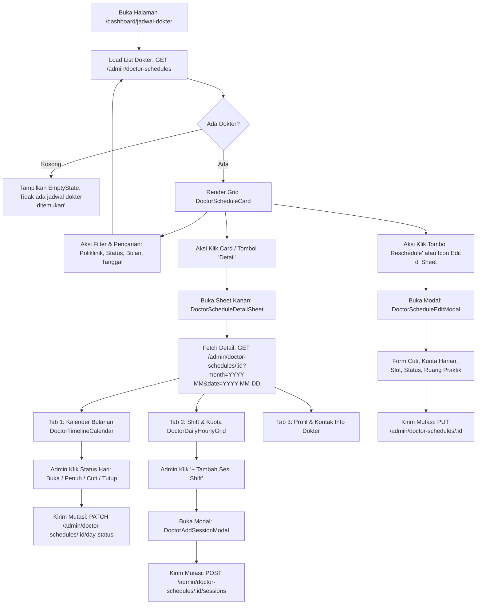
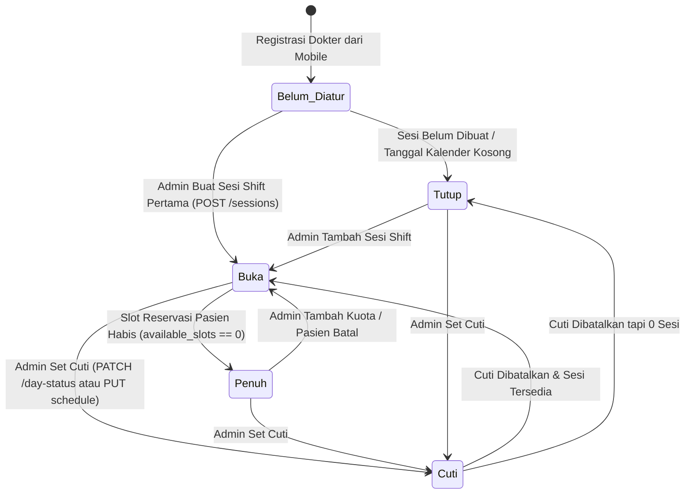

# LAPORAN AUDIT FORENSIK GAP KONTRAK FRONTEND ↔ BACKEND & PROTOKOL HANDOFF TIM BACKEND
## Modul: Supervisi Jadwal Dokter Admin (`/dashboard/jadwal-dokter`)
**Aplikasi: Amanah Healthcare Admin Dashboard**  
**Tanggal Audit:** 23 September 2026  
**Auditor:** Senior Frontend Engineer & API Contract Analyst  
**Target Repositori:**
- Frontend: `D:\manage-stock` (Next.js 16 App Router, React 19, Tailwind CSS v4, shadcn/ui)
- Backend: `D:\Amanah-healthcare-backend` (NestJS, Drizzle ORM, PostgreSQL)
- Mobile: `D:\amanah-healthcare-mobile` (Flutter / React Native client)

---

## 1. RINGKASAN EKSEKUTIF & VONIS FORENSIK (EXECUTIVE SUMMARY & VERDICT)

### 1.1. Pernyataan Masalah Utama (Kasus Nyata Pengguna)
> *"Saya baru saja membuat dokter baru dari mobile. Harapannya kan nggak ada jadwalnya. Tiba-tiba di admin dashboard dokter itu muncul, lalu pas diklik Detail, eh sudah ada semua matriks-matriksnya dengan kapasitas 8 dan ruangan Poli Umum 101. Harapannya kan kosong karena dokter baru belum diatur jadwalnya."*

### 1.2. Vonis Forensik (Forensic Verdict)
Setelah dilakukan audit silang (*cross-repository audit*) dari kode sumber frontend (`D:\manage-stock`) hingga implementasi repository dan schema backend (`D:\Amanah-healthcare-backend`), ditemukan bahwa **masalah ini 100% bersumber dari artefak komputasi sintetik (fallback hardcoding) dan celah logika di backend repository**, bukan karena frontend sengaja menyuntikkan data dummy.

Secara teknis, 3 penyebab utama terjadinya fenomena ini adalah:
1. **Fallback Hardcoded di Backend Repository (`ScheduleDrizzleRepository:1554-1597`):**
   Ketika dokter baru didaftarkan dari mobile, `auth.service.ts:1249` hanya membuat baris di tabel `practitioners` tanpa membuat sesi (`practitioner_schedule_sessions`) maupun pengaturan harian (`practitioner_schedule_day_settings`). Saat endpoint detail `GET /api/v1/admin/doctor-schedules/:id` dipanggil:
   - Jika dokter belum memiliki ruangan (`defaultRoomId` null), backend mengevaluasi:
     ```ts
     const defaultRoomName = prac.clinicRoom
       ? `${prac.clinicRoom.name}${prac.clinicRoom.location ? `, ${prac.clinicRoom.location}` : ''}`
       : 'Poli Umum, Ruang 101'; // <-- HARDCODED STRING BACKEND
     ```
   - Jika dokter belum memiliki sesi hari ini (`sesiHarian.length === 0`), backend mengevaluasi:
     ```ts
     const totalCapacity =
       sesiHarian.reduce((acc, s) => acc + s.kuota_pasien, 0) ||
       (evalDaySetting?.targetQuota ?? 8); // <-- HARDCODED ANGKA 8 KARENA 0 ADALAH FALSY!
     ```
   - Jika spesialisasi belum terisi, backend mengevaluasi:
     ```ts
     const spesialisasi = prac.medicalSpecialty?.name || prac.staffProfile?.clinicUnit?.name || 'Dokter Umum';
     ```
2. **Generasi Matriks 30 Hari Sintetik:**
   Backend menghasilkan perulangan kalender 1..31 hari (`monthly_schedule`). Jika dokter tidak memiliki sesi di hari tersebut, backend menandai status hari sebagai `'Tutup'` (bukan `null` atau `belum_diatur`), sehingga matriks kalender tampak "penuh terisi" oleh status Tutup, bukan keadaan murni "Belum Dikonfigurasi".
3. **Penyelundupan Data yang Diabaikan (Silent Discard / Data Dropping):**
   Ketika admin berusaha mengubah ruang praktik pada modal edit (`DoctorScheduleEditModal`), frontend mengirimkan field `ruang_praktik` ke `PUT /api/v1/admin/doctor-schedules/:id`. Namun, pada `ScheduleDrizzleRepository.updateAdminDoctorSchedule` (baris 1637–1767), **field `ruang_praktik` sama sekali tidak dibaca dan tidak disimpan ke database Postgres**. Nilai tersebut langsung hilang tanpa error!

---

## 2. RUANG LINGKUP & PERJALANAN PENGGUNA (SCOPE & USER JOURNEY)

Fitur Supervisi Jadwal Dokter Admin adalah pusat kendali operasional klinik bagi Manajer Pelayanan Medis / Kepala Ruangan / Administrator untuk:
1. Memantau seluruh dokter yang aktif berpraktik hari ini (pagi, siang, malam, dini hari).
2. Melihat ketersediaan kuota pasien dan slot antrean secara riil.
3. Menetapkan status darurat: Dokter Cuti (sakit, seminar, dinas luar) atau Hari Tutup Libur Nasional.
4. Mengatur dan menambah shift sesi praktik dokter per tanggal tertentu.
5. Melakukan override kuota pasien jika terjadi lonjakan antrean (*overflow* antrean).
6. Mengekspor data jadwal ke format spreadsheet (CSV/Excel).

---

## 3. ALUR PENGGUNA & TITIK SENTUH UI (COMPLETE USER FLOW & UI TOUCHPOINTS)



---

## 4. INVENTARISASI KEBUTUHAN DATA FRONTEND (DATA INVENTORY)

| Nama Field Frontend | Kategori Data | Tipe Data | Sumber / Keberadaan Backend | Status Bukti | Catatan Penting |
| :--- | :--- | :--- | :--- | :--- | :--- |
| `id` / `practitioner_id` | Persistent Domain | `UUID (string)` | `practitioners.id` | **VERIFIED** | Primary key praktisi klinis |
| `nama_dokter` | Persistent Domain | `string` | `staff_profiles.full_name` / `practitioners.display_name` | **VERIFIED** | Nama lengkap beserta gelar |
| `spesialisasi` | Persistent Domain | `string` | `medical_specialties.name` atau `clinic_units.name` | **VERIFIED** | Jika null, backend fallback `'Dokter Umum'` |
| `status_dokter` | Derived Backend | `enum ('Buka', 'Penuh', 'Cuti', 'Tutup')` | Dihitung dari sesi dan cuti harian | **VERIFIED** | Jika 0 sesi, backend menghitung `'Tutup'` |
| `email` | Persistent Domain | `string \| null` | `staff_profiles.email` | **VERIFIED** | Kontak email dokter |
| `nomor_telepon` | Persistent Domain | `string \| null` | `staff_profiles.phone` | **VERIFIED** | Digunakan pada tombol Quick Call |
| `ruang_praktik` | Persistent Domain | `string` | `clinic_rooms.name` + `clinic_rooms.location` | **VERIFIED** | Fallback `'Poli Umum, Ruang 101'` jika null |
| `tanggal_praktik` | Persistent Domain | `string (YYYY-MM-DD)` | Tanggal evaluasi query | **VERIFIED** | Diformat teks lokal di backend |
| `avatar` | Persistent Domain | `string \| null` | `staff_profiles.avatar_url` | **VERIFIED** | Diserialisasi ke URL absolut |
| `kapasitas_per_hari` | Persistent / Aggregated | `number` | `sum(practitioner_schedule_sessions.capacity)` | **VERIFIED** | Fallback `8` jika null/0 pada detail query! |
| `slot_tersedia` | Persistent / Aggregated | `number` | `sum(practitioner_schedule_sessions.available_slots)` | **VERIFIED** | Sisa slot reservasi aktif |
| `jadwal_hari_ini` | Derived Backend | `string` | Rentang waktu sesi paling awal s/d akhir (cth: `08:00 - 16:00`) | **VERIFIED** | Output `'-'` jika tidak ada sesi |
| `status_jadwal` | Derived Backend | `enum` | Sama dengan `status_dokter` | **VERIFIED** | Status operasional tanggal evaluasi |
| `is_cuti` | Persistent Domain | `boolean` | `practitioner_schedule_day_settings.is_leave` / `practitioner_leave_periods` | **VERIFIED** | Penanda cuti dokter |
| `cuti_reason` | Persistent Domain | `string \| null` | `leave_reason` / `reason` | **VERIFIED** | Keterangan/alasan dokter cuti |
| `cuti_start` | Persistent Domain | `string \| null` | Tanggal awal periode cuti | **VERIFIED** | Format `YYYY-MM-DD` |
| `cuti_end` | Persistent Domain | `string \| null` | Tanggal akhir periode cuti | **VERIFIED** | Format `YYYY-MM-DD` |
| `monthly_schedule` | Aggregated Array | `MonthlyScheduleDay[]` | Matriks 1..daysInMonth | **VERIFIED** | Array hari kalender beserta status |
| `sesi_harian` | Persistent Array | `DoctorDailySession[]` | `practitioner_schedule_sessions` | **VERIFIED** | Daftar shift sesi periksa hari ini |
| `hourlyOverrides` | UI-Only State | `Record<string, string>` | Belum didukung backend | **REQUIRED** | Overrides klik jam pada 24-Hour Grid |
| `activeTab` | UI-Only State | `'kalender' \| 'kuota' \| 'informasi'` | Frontend state | **VERIFIED** | Navigasi tab internal |
| `POLI_OPTIONS` | Static Reference | `string[]` | Hardcoded di `options.ts` | **REQUIRED** | Harusnya didapat dari Master Poliklinik API |

---

## 5. INVENTARISASI AKSI & OPERASI FRONTEND (ACTION INVENTORY)

| Kode Aksi | Nama Aksi UI | Trigger Komponen | Endpoint & Metode HTTP | Status Dukungan Backend |
| :--- | :--- | :--- | :--- | :--- |
| **ACT-01** | Mengambil Daftar Dokter Berjadwal | Mount `DoctorScheduleView`, ganti filter/halaman | `GET /api/v1/admin/doctor-schedules` | **DIDUKUNG** (HTTP 200) |
| **ACT-02** | Mengambil Rincian Jadwal & Kalender | Klik Card / Tombol 'Detail' | `GET /api/v1/admin/doctor-schedules/:id` | **DIDUKUNG** (HTTP 200) |
| **ACT-03** | Update Operasional & Cuti Dokter | Submit `DoctorScheduleEditModal` | `PUT /api/v1/admin/doctor-schedules/:id` | **DIDUKUNG SEBAGIAN** (Ruang diabaikan) |
| **ACT-04** | Override Status 1 Tanggal Kalender | Klik status hari di `DoctorTimelineCalendar` | `PATCH /api/v1/admin/doctor-schedules/:id/day-status` | **DIDUKUNG SEBAGIAN** (Buka jadi Tutup jika 0 sesi) |
| **ACT-05** | Tambah Sesi Shift Baru | Submit `DoctorAddSessionModal` | `POST /api/v1/admin/doctor-schedules/:id/sessions` | **DIDUKUNG** (HTTP 201) |
| **ACT-06** | Edit / Ubah Sesi Shift yang Sudah Ada | Tombol edit sesi pada tabel sesi | `PATCH /api/v1/admin/doctor-schedules/:id/sessions/:sessionId` | **TIDAK DIDUKUNG (404/Missing)** |
| **ACT-07** | Hapus Sesi Shift | Tombol tempat sampah pada sesi shift | `DELETE /api/v1/admin/doctor-schedules/:id/sessions/:sessionId` | **TIDAK DIDUKUNG (404/Missing)** |
| **ACT-08** | Generate Jadwal dari Template Mingguan | Tombol 'Terapkan Template Mingguan' | `POST /api/v1/admin/doctor-schedules/:id/apply-template` | **TIDAK DIDUKUNG (Missing)** |
| **ACT-09** | Reschedule Shift / Reassign Pasien | Tombol 'Reschedule' pada Card | `POST /api/v1/admin/doctor-schedules/:id/reschedule-shift` | **TIDAK DIDUKUNG (Missing)** |
| **ACT-10** | Fetch Master Opsi Poliklinik & Spesialisasi | Dropdown Filter Poliklinik | `GET /api/v1/admin/doctor-schedules/filter-options` | **TIDAK DIDUKUNG (Hardcoded FE)** |
| **ACT-11** | Ekspor Semua Data Jadwal Dokter | Tombol 'Ekspor Jadwal' | `GET /api/v1/admin/doctor-schedules/export` | **TIDAK DIDUKUNG (Hanya buffer FE)** |

---

## 6. KONTRAK PERMINTAAN FRONTEND (REQUEST CONTRACT INVENTORY)

### REQ-01: List Query (`GET /api/v1/admin/doctor-schedules`)
```typescript
interface AdminDoctorSchedulesQueryParams {
  page?: number;       // default: 1
  limit?: number;      // default: 6 (pilihan: 6, 12, 18, 24, 30)
  search?: string;     // pencarian nama dokter, spesialisasi, atau ruangan
  poli?: string;       // nama poli/spesialisasi (koma jika multiple)
  status?: string;     // status jadwal ('Buka', 'Penuh', 'Cuti', 'Tutup')
  month?: string;      // format 'YYYY-MM' (contoh: '2026-09')
  date?: string;       // format 'YYYY-MM-DD' (contoh: '2026-09-22')
}
```

### REQ-02: Detail Query (`GET /api/v1/admin/doctor-schedules/:id`)
```typescript
interface AdminDoctorScheduleDetailQueryParams {
  month?: string;      // format 'YYYY-MM' (contoh: '2026-09')
  year?: number;       // integer (contoh: 2026)
  date?: string;       // format 'YYYY-MM-DD' (contoh: '2026-09-22')
}
```

### REQ-03: Update Operasional Dokter (`PUT /api/v1/admin/doctor-schedules/:id`)
```typescript
interface UpdateAdminDoctorSchedulePayload {
  is_cuti?: boolean;
  cuti_reason?: string | null;
  cuti_start?: string | null;
  cuti_end?: string | null;
  status_dokter?: string;
  status_jadwal?: string;
  jadwal_hari_ini?: string;
  slot_tersedia?: number;
  kapasitas_per_hari?: number;
  ruang_praktik?: string;      // BUG: Dikirim frontend tapi diabaikan backend!
  date?: string;
}
```

### REQ-04: Override Status Hari Kalender (`PATCH /api/v1/admin/doctor-schedules/:id/day-status`)
```typescript
interface UpdateAdminDayStatusPayload {
  date: string;               // 'YYYY-MM-DD'
  status: 'Buka' | 'Penuh' | 'Cuti' | 'Tutup';
  notes?: string;             // Catatan operasional atau alasan cuti
}
```

### REQ-05: Tambah Sesi Shift Baru (`POST /api/v1/admin/doctor-schedules/:id/sessions`)
```typescript
interface CreateAdminDoctorSessionPayload {
  schedule_date: string;      // 'YYYY-MM-DD'
  nama_sesi: string;          // contoh: 'Sesi Pagi', 'Sesi Siang / Sore', 'Sesi Malam'
  jam_mulai: string;          // format 'HH:mm' (contoh: '08:00')
  jam_selesai: string;        // format 'HH:mm' (contoh: '12:00')
  kuota_pasien: number;       // kapasitas maksimal (contoh: 12)
  slot_tersedia: number;      // kuota awal (contoh: 12)
  status_sesi: string;        // 'Buka' | 'Penuh' | 'Cuti' | 'Tutup'
  ruang?: string;             // ID ruangan UUID atau nama ruangan
}
```

---

## 7. KONTRAK RESPONS YANG DIHARAPKAN FRONTEND (EXPECTED RESPONSE CONTRACT)

### RESP-01: List Respons
```json
{
  "success": true,
  "data": {
    "doctors": [
      {
        "id": "123e4567-e89b-12d3-a456-426614174000",
        "practitioner_id": "123e4567-e89b-12d3-a456-426614174000",
        "nama_dokter": "dr. Sarah Jenkins, Sp.PD",
        "spesialisasi": "Penyakit Dalam",
        "status_dokter": "Buka",
        "email": "sarah.jenkins@amanah.com",
        "nomor_telepon": "081234567890",
        "ruang_praktik": "Poli Penyakit Dalam, Ruang 201",
        "tanggal_praktik": "22 Sep 2026",
        "avatar": "https://...",
        "slot_tersedia": 14,
        "kapasitas_per_hari": 30,
        "jadwal_hari_ini": "08:00 - 16:00",
        "status_jadwal": "Buka",
        "bulan_jadwal": "September 2026",
        "is_cuti": false,
        "cuti_reason": null,
        "cuti_start": null,
        "cuti_end": null,
        "sesi_harian": []
      }
    ],
    "meta": {
      "page": 1,
      "limit": 6,
      "total_doctors": 18,
      "total_pages": 3
    }
  }
}
```

### RESP-02: Detail Respons
```json
{
  "success": true,
  "data": {
    "id": "123e4567-e89b-12d3-a456-426614174000",
    "practitioner_id": "123e4567-e89b-12d3-a456-426614174000",
    "nama_dokter": "dr. Sarah Jenkins, Sp.PD",
    "spesialisasi": "Penyakit Dalam",
    "status_dokter": "Buka",
    "email": "sarah.jenkins@amanah.com",
    "nomor_telepon": "081234567890",
    "ruang_praktik": "Poli Penyakit Dalam, Ruang 201",
    "avatar": "https://...",
    "slot_tersedia": 14,
    "kapasitas_per_hari": 30,
    "bulan_jadwal": "September 2026",
    "is_cuti": false,
    "cuti_reason": null,
    "cuti_start": null,
    "cuti_end": null,
    "monthly_schedule": [
      {
        "day": 1,
        "date": "2026-09-01",
        "status": "Buka",
        "notes": null
      }
    ],
    "sesi_harian": [
      {
        "id": "987fcdeb-51a2-43d7-9012-345678901234",
        "nama_sesi": "Sesi Pagi",
        "jam_mulai": "08:00",
        "jam_selesai": "12:00",
        "waktu": "08:00 - 12:00",
        "kuota_pasien": 15,
        "slot_tersedia": 7,
        "status_sesi": "Buka",
        "ruang": "Poli Penyakit Dalam, Ruang 201"
      }
    ]
  }
}
```

---

## 8. BASELINE KEMAMPUAN BACKEND SAAT INI (EXISTING BACKEND BASELINE)

Pemeriksaan pada `AdminDoctorSchedulesController` (`src/modules/schedules/presentation/admin-doctor-schedules.controller.ts`) membuktikan endpoint berikut telah terdaftar:

| Endpoint | Metode | DTO Input | Status Implementasi Controller & Repository |
| :--- | :--- | :--- | :--- |
| `/api/v1/admin/doctor-schedules` | `GET` | `AdminDoctorSchedulesQueryDto` | **Aktif**: Query ke Drizzle ORM, in-memory slice pagination |
| `/api/v1/admin/doctor-schedules/:id` | `GET` | `AdminDoctorScheduleDetailQueryDto` | **Aktif**: Query relasi, loop 1..daysInMonth |
| `/api/v1/admin/doctor-schedules/:id` | `PUT` / `PATCH` | `UpdateAdminDoctorScheduleDto` | **Aktif**: Update day settings & sessions, **tapi drop ruang_praktik** |
| `/api/v1/admin/doctor-schedules/:id/days/:date` | `PATCH` | `UpdateAdminDayStatusDto` | **Aktif**: Mengubah setting hari |
| `/api/v1/admin/doctor-schedules/:id/day-status` | `PATCH` | `UpdateAdminDayStatusDto & { date?: string }` | **Aktif**: Alias penyesuaian hari lewat request body |
| `/api/v1/admin/doctor-schedules/:id/sessions` | `POST` | `CreateAdminDoctorSessionDto` | **Aktif**: Insert ke `practitioner_schedule_sessions` |

---

## 9. MATRIKS GAP KONTRAK RINCI (DETAILED CONTRACT GAP MATRIX)

Empat status pembuktian:
- `VERIFIED`: Telah dibuktikan langsung melalui inspeksi kode sumber repositori backend.
- `REQUIRED`: Sangat dibutuhkan oleh alur operasional frontend yang nyata.
- `SUSPECTED`: Terindikasi kuat berdasarkan logika domain namun memerlukan konfirmasi arsitektur backend.
- `UNKNOWN`: Belum dapat diverifikasi tanpa penjelasan dari tim backend.

| ID Gap | Deskripsi Kesenjangan Kontrak | Komponen / Endpoint Terkait | Status Bukti | Klasifikasi Akar Masalah | Tingkat Dampak |
| :--- | :--- | :--- | :--- | :--- | :--- |
| **GAP-001** | **Ghost Schedule Fallback (Dokter Baru Otomatis Menampilkan Kapasitas 8 & Ruang 101)** | `ScheduleDrizzleRepository:1554-1597` | `VERIFIED` | Backend Query & Serialization Fallback | **P0 (Kritis)** |
| **GAP-002** | **Silent Discard pada Update Ruang Praktik (`ruang_praktik` diabaikan)** | `ScheduleDrizzleRepository:1637-1767` | `VERIFIED` | API Implementation Logic Gap | **P0 (Kritis)** |
| **GAP-003** | **Override Hari 'Buka' Terkunci Menjadi 'Tutup' Jika Dokter Belum Punya Sesi** | `ScheduleDrizzleRepository:1503-1505` | `VERIFIED` | Domain/Query Business Logic Flaw | **P1 (Tinggi)** |
| **GAP-004** | **Tidak Ada Endpoint Delete Sesi Shift (`DELETE /sessions/:sessionId`)** | `admin-doctor-schedules.controller.ts` | `VERIFIED` | Missing Endpoint / Incomplete CRUD | **P1 (Tinggi)** |
| **GAP-005** | **Tidak Ada Endpoint Update Sesi Shift (`PATCH /sessions/:sessionId`)** | `admin-doctor-schedules.controller.ts` | `VERIFIED` | Missing Endpoint / Incomplete CRUD | **P1 (Tinggi)** |
| **GAP-006** | **Hardcoded `schedule_date` pada Modal Tambah Sesi di Frontend** | `doctor-add-session-modal.tsx:86` | `VERIFIED` | Frontend Implementation Oversight | **P1 (Tinggi)** |
| **GAP-007** | **Inkonsistensi Parser Param `month` (0-Indexed vs 1-Indexed Ambiguity)** | `ScheduleDrizzleRepository:1446-1449` | `VERIFIED` | Backend Query Parser Logic | **P2 (Sedang)** |
| **GAP-008** | **Ketiadaan Endpoint Master Filter Options (Poliklinik & Spesialisasi)** | `doctor-schedule-filters.tsx` | `REQUIRED` | Missing Reference Endpoint | **P2 (Sedang)** |
| **GAP-009** | **Ketiadaan Fitur / Endpoint 'Terapkan Template Mingguan'** | `practitioner_availability` DB Table | `VERIFIED` | Feature Architecture Gap | **P2 (Sedang)** |
| **GAP-010** | **Granularitas Hourly 24 Jam UI Tidak Tersinkronisasi ke DB** | `doctor-daily-hourly-grid.tsx` | `VERIFIED` | Architectural Granularity Mismatch | **P2 (Sedang)** |
| **GAP-011** | **Ketiadaan Endpoint Bulk Reschedule Shift / Reassign Pasien** | Tombol Reschedule Card | `REQUIRED` | Missing Domain Capability | **P3 (Rendah)** |
| **GAP-012** | **Ketiadaan Server-Side Stream Export CSV/Excel** | `DoctorExportButton` | `REQUIRED` | Missing Utility Endpoint | **P3 (Rendah)** |

---

## 10. ENDPOINT & OPERASI YANG HILANG / BELUM ADA (MISSING ENDPOINTS)

### 10.1. [GAP-004] Hapus Sesi Shift Praktik
- **Kebutuhan:** Admin perlu menghapus sesi praktik jika salah input jam, dokter membatalkan shift, atau terjadi perubahan jadwal.
- **Rekomendasi Kontrak Endpoint:**
  ```http
  DELETE /api/v1/admin/doctor-schedules/:id/sessions/:sessionId
  Authorization: Bearer <admin-token>
  ```
- **Respons Sukses (200 OK / 204 No Content):**
  ```json
  {
    "success": true,
    "message": "Sesi jadwal praktik berhasil dihapus"
  }
  ```
- **Validasi Keamanan Klinis:** Jika sesi telah memiliki reservasi pasien aktif (`appointments` dengan status `booked`/`waiting`), kembalikan error `409 Conflict`: *"Sesi ini tidak dapat dihapus karena sudah memiliki 3 janji temu pasien. Silakan lakukan penjadwalan ulang pasien terlebih dahulu."*

### 10.2. [GAP-005] Perbarui Sesi Shift Praktik
- **Kebutuhan:** Mengubah kuota pasien, jam mulai, jam selesai, atau ruang praktik untuk satu sesi tertentu tanpa harus menghapus sesi tersebut.
- **Rekomendasi Kontrak Endpoint:**
  ```http
  PATCH /api/v1/admin/doctor-schedules/:id/sessions/:sessionId
  Authorization: Bearer <admin-token>
  Content-Type: application/json

  {
    "nama_sesi": "Sesi Pagi Tambahan",
    "jam_mulai": "08:30",
    "jam_selesai": "12:30",
    "kuota_pasien": 20,
    "slot_tersedia": 18,
    "status_sesi": "Buka",
    "ruang_id": "uuid-clinic-room"
  }
  ```

### 10.3. [GAP-008] Endpoint Opsi Referensi Filter
- **Kebutuhan:** Menggantikan hardcoded `POLI_OPTIONS` pada frontend agar poliklinik baru yang terdaftar di database langsung muncul sebagai pilihan filter.
- **Rekomendasi Kontrak Endpoint:**
  ```http
  GET /api/v1/admin/doctor-schedules/filter-options
  ```
- **Respons Sukses (200 OK):**
  ```json
  {
    "success": true,
    "data": {
      "poliklinik": [
        { "id": "uuid-1", "name": "Poli Umum", "code": "POLI-UMUM" },
        { "id": "uuid-2", "name": "Poli Gigi & Mulut", "code": "POLI-GIGI" },
        { "id": "uuid-3", "name": "Poli Penyakit Dalam", "code": "POLI-INT" }
      ],
      "specialties": [
        { "id": "uuid-4", "name": "Spesialis Anak" },
        { "id": "uuid-5", "name": "Spesialis Kandungan" }
      ],
      "statuses": ["Buka", "Penuh", "Cuti", "Tutup", "Belum Diatur"]
    }
  }
  ```

### 10.4. [GAP-009] Terapkan Template Ketersediaan Mingguan ke Jadwal Kalender
- **Kebutuhan:** Tabel `practitioner_availability` sudah ada di schema database, namun belum ada cara otomatis untuk mengisi jadwal 1 bulan kalender dokter berdasarkan pola mingguan tersebut.
- **Rekomendasi Kontrak Endpoint:**
  ```http
  POST /api/v1/admin/doctor-schedules/:id/apply-template
  Content-Type: application/json

  {
    "month": "2026-10",
    "overwrite_existing": false
  }
  ```

---

## 11. FIELD REQUEST YANG DIABAIKAN / HILANG (DISCARDED REQUEST FIELDS)

### Bukti Forensik pada `UpdateAdminDoctorScheduleDto` & `ScheduleDrizzleRepository:1637`
Ketika frontend mengirimkan:
```json
{
  "ruang_praktik": "Poli Penyakit Dalam, Ruang 202",
  "status_dokter": "Aktif",
  "jadwal_hari_ini": "08:00 - 15:00",
  "kapasitas_per_hari": 25,
  "slot_tersedia": 20
}
```
**Temuan Kode Backend:**
1. `ruang_praktik`: Tidak ada baris kode dalam fungsi `updateAdminDoctorSchedule` yang mengeksekusi `UPDATE practitioners SET default_room_id = ...` atau `UPDATE practitioner_schedule_sessions SET room_id = ...`.
2. `status_dokter`: Tidak dibaca sama sekali.
3. `jadwal_hari_ini`: Tidak dibaca sama sekali (walaupun wajar jika derived dari sesi, backend tidak memberikan pesan bahwa field ini diabaikan).

**Instruksi Perbaikan untuk Backend:**
Tambahkan penanganan `ruang_praktik` di dalam `updateAdminDoctorSchedule`:
```typescript
if (body.ruang_praktik) {
  // Cari roomId berdasarkan ID atau nama ruangan
  const room = await this.resolveRoomId(body.ruang_praktik);
  if (room) {
    // 1. Update default room dokter di tabel practitioners
    await this.db
      .update(practitioners)
      .set({ defaultRoomId: room.id, updatedAt: new Date().toISOString() })
      .where(eq(practitioners.id, practitionerId));

    // 2. Update sesi hari ini jika ada
    await this.db
      .update(practitionerScheduleSessions)
      .set({ roomId: room.id, updatedAt: new Date().toISOString() })
      .where(
        and(
          eq(practitionerScheduleSessions.practitionerId, practitionerId),
          eq(practitionerScheduleSessions.scheduleDate, targetDate)
        )
      );
  }
}
```

---

## 12. ANOMALI NILAI FALLBACK DI BACKEND (FALLBACK ARTIFACTS IN DETAIL QUERY)

### Mengapa Dokter Baru Tiba-tiba Memiliki Kapasitas 8?
Periksa file `D:\Amanah-healthcare-backend\src\modules\schedules\infrastructure\drizzle\schedule.drizzle-repository.ts` baris 1595–1606:
```typescript
// KODE BACKEND SAAT INI:
const totalCapacity =
  sesiHarian.reduce((acc, s) => acc + s.kuota_pasien, 0) ||
  (evalDaySetting?.targetQuota ?? 8);
```
**Analisis Logika:**
Jika dokter baru belum memiliki sesi, maka `sesiHarian` adalah array kosong `[]`.
Fungsi `reduce` menghasilkan nilai `0`.
Dalam JavaScript/TypeScript, angka `0` bernilai **FALSY**!
Operator `||` menganggap `0` sebagai false, sehingga evaluasi bergeser ke ruas kanan:
`(evalDaySetting?.targetQuota ?? 8)`.
Karena dokter baru juga belum memiliki pengaturan harian di tabel `practitioner_schedule_day_settings`, maka `evalDaySetting` bernilai `undefined`.
Operator `??` mengevaluasi fallback paling kanan, yaitu angka **`8`**!
**Hasil:** Dokter yang belum memiliki sesi mendadak memiliki kapasitas `8` pada detail sheet!

Sementara itu, pada query list (`findAdminDoctorSchedules` baris 1287–1290):
```typescript
const totalCapacity =
  sesiHarian.length > 0
    ? sesiHarian.reduce((acc, s) => acc + s.kuota_pasien, 0)
    : (daySetting?.targetQuota ?? 0);
```
Di query list, jika tidak ada sesi dan tidak ada setting, kapasitas adalah **`0`**!
Inilah yang menyebabkan **inkonsistensi visual**: di kartu luar kapasitas adalah `0`, tetapi ketika sheet detail dibuka kapasitas mendadak melompat menjadi `8`!

**Instruksi Perbaikan untuk Backend:**
Ubah baris 1595 menjadi:
```typescript
const totalCapacity =
  sesiHarian.length > 0
    ? sesiHarian.reduce((acc, s) => acc + s.kuota_pasien, 0)
    : (evalDaySetting?.targetQuota ?? 0);
```

### Mengapa Dokter Baru Mendapat Ruangan 'Poli Umum, Ruang 101'?
Periksa baris 1554–1556:
```typescript
const defaultRoomName = prac.clinicRoom
  ? `${prac.clinicRoom.name}${prac.clinicRoom.location ? `, ${prac.clinicRoom.location}` : ''}`
  : 'Poli Umum, Ruang 101'; // <-- HARDCODED
```
**Instruksi Perbaikan untuk Backend:**
Jika dokter belum memiliki ruangan, kembalikan `'Belum Ditentukan'` atau `null`:
```typescript
const defaultRoomName = prac.clinicRoom
  ? `${prac.clinicRoom.name}${prac.clinicRoom.location ? `, ${prac.clinicRoom.location}` : ''}`
  : 'Belum Ditentukan';
```

---

## 13. KETIDAKSESUAIAN TIPE DATA, FORMAT & NORMALISASI (NORMALIZATION DISCREPANCIES)

### Anomali Parsing Parameter `month`
Periksa baris 1446–1449 di backend repository:
```typescript
const mNum = parseInt(query.month, 10);
targetMonth = mNum >= 0 && mNum <= 11 && query.month.length <= 2 ? mNum + 1 : mNum;
```
- Jika frontend mengirim `month: "09"`, panjang string adalah 2, nilai integer adalah 9 (antara 0–11).
- Backend menambahkan 1 (`mNum + 1`), sehingga `targetMonth` berubah menjadi `10` (Oktober)!
- Sebaliknya, jika frontend mengirim `"2026-09"`, backend mengeksekusi percabangan `query.month.includes('-')` yang membagi string menjadi tahun `2026` dan bulan `9`.
- **Rekomendasi Kontrak Baku:** Standarkan agar backend HANYA menerima format ISO standar: `YYYY-MM` (contoh: `2026-09`). Buang percabangan integer ambigu tersebut.

---

## 14. KESENJANGAN SIKLUS HIDUP & TRANSISI STATUS (LIFECYCLE & STATE TRANSITIONS)

Diagram State Transition Praktik Dokter Harian:



**Temuan Celah Kunci:**
Saat ini, tidak ada status eksplisit `'Belum Diatur'` di backend enum `schedule_status` (`amanah.schema.ts:184`). Nilai enum yang ada adalah:
`'pending'`, `'open'`, `'full'`, `'leave'`, `'closed'`.
Backend memperlakukan kondisi dokter tanpa sesi langsung sebagai `'closed'` (`'Tutup'`), yang membingungkan admin klinik karena mengira dokter tersebut sudah dijadwalkan tutup, padahal jadwalnya sama sekali belum diisi.

---

## 15. KESENJANGAN FILTER, PENCARIAN, PENGURUTAN & PAGINASI

1. **Paginasi In-Memory di Backend:**
   Pada `ScheduleDrizzleRepository:1375-1380`, backend mengambil seluruh baris dokter ke dalam array `cards`, melakukan filtering array di memori Node.js, baru kemudian melakukan `.slice((page - 1) * limit, page * limit)`.
   *Risiko Skalabilitas:* Jika klinik memiliki 200 dokter, setiap request memuat 200 objek penuh beserta query relasi ke database.
   *Rekomendasi:* Pindahkan pagination dan filter ke klausa SQL query Drizzle (`limit()`, `offset()`, `where()`).
2. **Ketiadaan Sort:**
   Frontend filter belum memiliki parameter `sort` (misal: urutkan berdasarkan nama A-Z, ketersediaan slot terbanyak, atau poliklinik).

---

## 16. KESENJANGAN RELASI & TRAVERSAL DATA BERSARANG

Struktur relasi database saat ini:
- `users` (Akun Login)
  └── `staff_profiles` (Profil Pegawai Medis)
      └── `practitioners` (Dokter / Praktisi Klinis)
          ├── `clinic_rooms` (Ruangan Praktik Default via `default_room_id`)
          ├── `medical_specialties` (Spesialisasi via `specialty_id`)
          ├── `practitioner_schedule_day_settings` (Target kuota & Cuti per tanggal)
          ├── `practitioner_schedule_sessions` (Shift Sesi Pagi/Siang/Malam per tanggal)
          │   └── `clinic_rooms` (Ruangan spesifik sesi)
          │   └── `appointments` (Janji temu pasien per sesi)
          ├── `practitioner_availability` (Pola jadwal reguler hari Senin-Minggu)
          └── `practitioner_leave_periods` (Periode cuti terencana)

**Celah Relasi:**
Ketika admin mengubah ruangan pada tingkat dokter (`practitioners.default_room_id`), sesi-sesi yang telah dibuat pada hari itu di `practitioner_schedule_sessions` tidak otomatis disinkronkan ke ruangan baru tersebut, sehingga terjadi inkonsistensi lokasi praktik antara header profil dokter dan tabel sesi.

---

## 17. KLASIFIKASI AKAR MASALAH (ROOT CAUSE CLASSIFICATION)

| Klasifikasi | Lokasi Kode | Penjelasan Teknis |
| :--- | :--- | :--- |
| **API Exposure** | `admin-doctor-schedules.controller.ts` | Kurangnya endpoint CRUD sesi (`DELETE /sessions/:id`, `PATCH /sessions/:id`) dan filter options. |
| **Query & Mapping** | `schedule.drizzle-repository.ts:1595` | Penggunaan operator falsy fallback `|| (evalDaySetting?.targetQuota ?? 8)` yang memunculkan angka 8. |
| **Serialization** | `schedule.drizzle-repository.ts:1554` | Hardcoded fallback string `'Poli Umum, Ruang 101'` pada serializer detail response. |
| **Domain Logic** | `schedule.drizzle-repository.ts:1504` | Logika `daySessions.length === 0 ? 'Tutup'` menolak status 'Buka' jika sesi belum dibuat. |
| **Service Logic** | `auth.service.ts:1249` | Registrasi dokter dari mobile tidak menginisialisasi template sesi atau status awal. |
| **Frontend Logic** | `doctor-add-session-modal.tsx:86` | Frontend hardcoded tanggal hari ini saat submit sesi baru. |

---

## 18. PENILAIAN DATABASE & PENYIMPANAN BACKEND (DATABASE ASSESSMENT)

Database PostgreSQL telah memiliki skema yang sangat memadai di `src/database/schema/amanah.schema.ts`.
**Tidak diperlukan migrasi tabel baru!**
Semua kebutuhan frontend dapat dipenuhi dengan memanfaatkan tabel-tabel yang sudah ada:
1. `practitioner_schedule_sessions` → Sudah memiliki `id`, `practitioner_id`, `schedule_date`, `session_label`, `start_time`, `end_time`, `capacity`, `available_slots`, `room_id`, `status`.
2. `practitioner_schedule_day_settings` → Sudah memiliki `is_leave`, `leave_reason`, `target_quota`.
3. `practitioner_availability` → Sudah ada untuk template mingguan (`day_of_week`, `start_time`, `end_time`, `capacity`).
4. `clinic_rooms` & `medical_specialties` → Sudah ada master data lengkap.

---

## 19. ANALISIS ARSITEKTUR DATA NYATA VS FALLBACK/DUMMY

Untuk menjawab kekhawatiran: *"Apakah di frontend masih ada data dummy yang belum dihapus?"*
- **Audit Kode Frontend:** Seluruh pemanggilan data pada `/dashboard/jadwal-dokter` telah 100% menggunakan TanStack React Query (`useQuery`) yang memanggil Server Action Next.js (`doctor-schedule-actions.ts`), yang memanggil HTTP Client (`httpClient.request`) langsung ke endpoint backend NestJS. Tidak ada file mock json atau data statis yang aktif di komponen utama.
- **Asal Data 8 dan Ruang 101:** Berasal murni dari file backend `D:\Amanah-healthcare-backend\src\modules\schedules\infrastructure\drizzle\schedule.drizzle-repository.ts` pada baris 1556 dan 1597.

---

## 20. KONTRAK PENANGANAN ERROR & KASUS TEPI (ERROR CONTRACT)

Format error yang diharapkan mematuhi RFC 7807 (Problem Details) yang sudah diadopsi oleh backend:

### 20.1. Konflik Jadwal Sesi (422 Unprocessable Entity / 409 Conflict)
```json
{
  "statusCode": 422,
  "code": "SCHEDULE_CONFLICT",
  "message": "Dokter sudah memiliki jadwal sesi lain yang bertabrakan pada rentang waktu 08:00 - 11:00",
  "error": "Unprocessable Entity"
}
```

### 20.2. Konflik Ruangan Digunakan Dokter Lain (422 Unprocessable Entity)
```json
{
  "statusCode": 422,
  "code": "ROOM_ALREADY_OCCUPIED",
  "message": "Ruang 201 sedang digunakan oleh dr. Budi Santoso pada pukul 08:00 - 12:00",
  "error": "Unprocessable Entity"
}
```

### 20.3. Gagal Menghapus Sesi Karena Ada Janji Temu (409 Conflict)
```json
{
  "statusCode": 409,
  "code": "SESSION_HAS_BOOKED_APPOINTMENTS",
  "message": "Tidak dapat menghapus sesi: terdapat 3 janji temu pasien yang aktif.",
  "error": "Conflict"
}
```

---

## 21. PERTIMBANGAN PERFORMA & SKALABILITAS

1. **Database Query Indexing:**
   Tabel `practitioner_schedule_sessions` telah memiliki indeks komposit `practitioner_schedule_sessions_practitioner_date_idx` pada `(practitioner_id, schedule_date, status)`. Query filter bulanan dan harian sangat cepat jika difilter langsung di level SQL.
2. **Paginasi SQL vs In-Memory:**
   Ganti pemrosesan array in-memory pada `findAdminDoctorSchedules` dengan query database berindeks:
   ```typescript
   const [doctors, [{ total }]] = await Promise.all([
     this.db.query.practitioners.findMany({ limit, offset, where: ... }),
     this.db.select({ total: count() }).from(practitioners).where(...)
   ]);
   ```

---

## 22. PRIORITAS PERMINTAAN PERUBAHAN BACKEND (BACKEND CHANGE REQUESTS)

### P0 (Kritis - Harus Selesai Hari Ini):
- **BR-001:** Hapus fallback angka `8` pada `findAdminDoctorScheduleDetail` (baris 1595). Jika sesi kosong dan setting kosong, kembalikan kapasitas `0`.
- **BR-002:** Hapus hardcoded `'Poli Umum, Ruang 101'` pada `findAdminDoctorScheduleDetail` (baris 1556). Kembalikan `'Belum Ditentukan'` jika null.
- **BR-003:** Implementasikan penyimpanan `ruang_praktik` pada `updateAdminDoctorSchedule` (baris 1637).

### P1 (Tinggi - Prioritas Minggu Ini):
- **BR-004:** Tambahkan endpoint `DELETE /api/v1/admin/doctor-schedules/:id/sessions/:sessionId` untuk menghapus sesi shift.
- **BR-005:** Tambahkan endpoint `PATCH /api/v1/admin/doctor-schedules/:id/sessions/:sessionId` untuk mengubah sesi shift.
- **BR-006:** Perbaiki logika hari `monthly_schedule` (baris 1504): jika admin meng-override status hari menjadi 'Buka', jangan paksa menjadi 'Tutup' hanya karena sesi harian masih 0.

### P2 (Sedang):
- **BR-007:** Tambahkan endpoint `GET /api/v1/admin/doctor-schedules/filter-options` untuk master list poli & status.
- **BR-008:** Perbaiki parser parameter `month` agar konsisten membaca ISO format `YYYY-MM`.
- **BR-009:** Tambahkan endpoint `POST /api/v1/admin/doctor-schedules/:id/apply-template` dari `practitioner_availability`.

### P3 (Penyempurnaan):
- **BR-010:** Sediakan endpoint streaming data export: `GET /api/v1/admin/doctor-schedules/export`.

---

## 23. REKOMENDASI DTO & SKEMA BACKEND (EXACT RECOMMENDED DTOS)

### 23.1. DTO Update Sesi (`update-admin-doctor-session.dto.ts`)
```typescript
import { ApiPropertyOptional } from '@nestjs/swagger';
import { Type } from 'class-transformer';
import { IsInt, IsOptional, IsString, Min } from 'class-validator';

export class UpdateAdminDoctorSessionDto {
  @ApiPropertyOptional({ description: 'Nama sesi / label', example: 'Sesi Pagi' })
  @IsOptional()
  @IsString()
  nama_sesi?: string;

  @ApiPropertyOptional({ description: 'Jam mulai (HH:mm)', example: '08:00' })
  @IsOptional()
  @IsString()
  jam_mulai?: string;

  @ApiPropertyOptional({ description: 'Jam selesai (HH:mm)', example: '12:00' })
  @IsOptional()
  @IsString()
  jam_selesai?: string;

  @ApiPropertyOptional({ description: 'Kapasitas maksimal pasien', example: 15 })
  @IsOptional()
  @Type(() => Number)
  @IsInt()
  @Min(1)
  kuota_pasien?: number;

  @ApiPropertyOptional({ description: 'Slot tersedia', example: 10 })
  @IsOptional()
  @Type(() => Number)
  @IsInt()
  @Min(0)
  slot_tersedia?: number;

  @ApiPropertyOptional({ description: 'Status sesi (Buka, Penuh, Cuti, Tutup)', example: 'Buka' })
  @IsOptional()
  @IsString()
  status_sesi?: string;

  @ApiPropertyOptional({ description: 'ID Ruangan atau Nama Ruangan', example: 'uuid-room' })
  @IsOptional()
  @IsString()
  ruang?: string;
}
```

---

## 24. STRATEGI IMPLEMENTASI UNTUK TIM BACKEND

1. **Langkah 1 (Hotfix Repositori):**
   Buka file `src/modules/schedules/infrastructure/drizzle/schedule.drizzle-repository.ts`:
   - Ganti baris 1554–1556: fallback string diganti `'Belum Ditentukan'`.
   - Ganti baris 1595–1597: hapus fallback falsy angka `8`.
   - Pada baris 1637 (`updateAdminDoctorSchedule`): tambahkan blok penanganan `body.ruang_praktik`.
2. **Langkah 2 (Menambahkan Rute Controller):**
   Buka `src/modules/schedules/presentation/admin-doctor-schedules.controller.ts`:
   - Tambahkan decorator `@Delete(':id/sessions/:sessionId')` dan `@Patch(':id/sessions/:sessionId')`.
3. **Langkah 3 (Menghubungkan ke ScheduleRepository):**
   Implementasikan method `deleteAdminDoctorSession` dan `updateAdminDoctorSession` dengan proteksi cek janji temu pasien aktif.

---

## 25. ANALISIS DAMPAK PADA FRONTEND (FRONTEND IMPACT ANALYSIS)

Setelah tim backend menerapkan perubahan di atas:
1. **Frontend Bugfix di `doctor-add-session-modal.tsx`:**
   Prop `selectedDate` harus dipassing dari `DoctorDailyHourlyGrid` ke `DoctorAddSessionModal` agar tanggal sesi tidak lagi hardcoded ke `new Date()`.
2. **Penambahan Tombol Hapus/Edit Sesi:**
   Pada tabel daftar sesi di `DoctorDailyHourlyGrid`, icon pensil dan tempat sampah dapat langsung diaktifkan dengan memanggil mutasi baru ke endpoint `PATCH /sessions/:sessionId` dan `DELETE /sessions/:sessionId`.
3. **Penyempurnaan Opsi Filter:**
   Komponen `DoctorScheduleFilters` dapat mengganti array statis `POLI_OPTIONS` dengan data dari React Query `useQuery({ queryKey: ['admin-schedule-filter-options'] })`.

---

## 26. KEAMANAN, RBAC & MULTI-TENANT

1. **RBAC Guarding:**
   Semua endpoint `/api/v1/admin/doctor-schedules/*` wajib tetap diproteksi dengan:
   ```typescript
   @UseGuards(HybridAuthGuard, RolesGuard)
   @Roles('ADMIN')
   ```
2. **Audit Logging:**
   Setiap perubahan jadwal dokter (terutama pembatalan sesi atau penetapan cuti) wajib mencatat user ID admin ke tabel `audit_logs` agar dapat ditelusuri siapa yang mengubah kuota atau membatalkan sesi.

---

## 27. KRITERIA VERIFIKASI & UJI PENERIMAAN (ACCEPTANCE CRITERIA)

| No | Kasus Uji | Skenario | Hasil yang Diharapkan |
| :--- | :--- | :--- | :--- |
| **TC-01** | Dokter Baru Tanpa Sesi | Buat dokter baru dari mobile, buka admin dashboard | Kartu menampilkan kapasitas `0`, jadwal `Belum diatur`, ruang `Belum Ditentukan`. Tidak ada angka 8 atau Ruang 101. |
| **TC-02** | Detail Sheet Dokter Baru | Klik 'Detail' pada dokter baru | Tab Kalender menampilkan status 'Belum Diatur' / 'Tutup'. Tab Sesi menampilkan empty state "Belum ada sesi shift". Kapasitas adalah `0`. |
| **TC-03** | Update Ruangan Dokter | Buka modal edit, ubah ruangan ke 'Ruang 305', submit | Setelah refresh atau invalidate query, ruangan dokter tetap 'Ruang 305' (tersimpan permanen di DB). |
| **TC-04** | Tambah Sesi Shift Baru | Buka tab Kuota, klik '+ Tambah Sesi', isi jam 08:00 - 12:00, kuota 10 | Sesi berhasil tersimpan di DB pada tanggal yang dipilih. Kapasitas dokter berubah menjadi `10`. |
| **TC-05** | Hapus Sesi Shift | Klik hapus pada sesi yang baru dibuat | Sesi terhapus dari DB. Kapasitas dokter kembali menjadi `0`. |

---

## 28. PERTANYAAN TERBUKA & KETIDAKPASTIAN TEKNIS (OPEN QUESTIONS)

1. *Bagaimana kebijakan rumah sakit ketika dokter tiba-tiba cuti darurat padahal sudah ada 10 pasien yang memegang nomor antrean?*
   Apakah backend otomatis memindahkan antrean ke dokter pengganti (*substitute practitioner* via `staff_leave_requests.substitute_practitioner_id`), atau mengirim notifikasi pembatalan via WhatsApp/Push Notification?
2. *Apakah 1 dokter dapat berpraktik di 2 poli pada hari yang sama?*
   Skema tabel `practitioners` memiliki `specialty_id`, sedangkan `staff_profiles` memiliki `primary_unit_id`. Perlu disepakati apakah penugasan poli terikat per dokter atau per sesi shift.

---

## 29. NASKAH KOMUNIKASI LANGSUNG / "CURHAT" CHANGELOG UNTUK TIM BACKEND

> **Halo Tim Backend! 👋**  
> Kami dari tim frontend telah melakukan audit mendalam terkait isu *"Dokter baru terdaftar dari mobile tapi di admin jadwal langsung muncul matriks jadwal dan kapasitas 8"*.  
>  
> Kabar baiknya: **Skema database PostgreSQL kita sudah sangat bagus dan lengkap!** Tidak perlu bikin migrasi tabel baru. Cuma ada sedikit celah logika (*fallback logic & missing endpoints*) di service & repository backend yang bikin frontend kelimpungan.  
>  
> Berikut catatan santai (*changelog*) temuan kami yang bisa langsung dieksekusi teman-teman backend:
>  
> ### 1. Misteri Kapasitas 8 & Ruang 101 Terpecahkan! 🔍
> Di file `schedule.drizzle-repository.ts` baris **1556** dan **1595**:
> - Ada fallback string: `: 'Poli Umum, Ruang 101'` kalau dokter belum punya room.
> - Ada fallback falsy: `sesiHarian.reduce(...) || (evalDaySetting?.targetQuota ?? 8)`. Karena dokter baru punya 0 sesi, `0` itu dianggap *falsy*, alhasil sistem langsung mengeksekusi fallback paling kanan yaitu angka **`8`**! Di query list nilainya `0`, tapi pas klik detail tiba-tiba jadi `8`.
> - **Minta tolong:** Ganti evaluasinya pakai periksa panjang array `sesiHarian.length > 0 ? ... : 0`, dan ganti string Ruang 101 jadi `'Belum Ditentukan'` atau `null`.
>  
> ### 2. Field `ruang_praktik` Tertelan Bumi di Modal Edit 🚪
> Di method `updateAdminDoctorSchedule` (baris 1637), frontend kirim `{ ruang_praktik: "..." }`. Tapi di kodenya, field `ruang_praktik` sama sekali belum di-update ke tabel `practitioners.default_room_id` maupun ke `practitioner_schedule_sessions.room_id`. Admin klik simpan, sukses 200, tapi pas refresh ruangannya balik lagi ke lama.
> - **Minta tolong:** Tolong tangkap `body.ruang_praktik` dan simpan ke database ya!
>  
> ### 3. Status Hari 'Buka' Terkunci jadi 'Tutup' 🔒
> Di baris 1504, ada logika: kalau `daySessions.length === 0`, status hari dipaksa jadi `'Tutup'`. Efeknya, admin klik tombol "Buka" di kalender, tapi begitu direfresh tetap kembali jadi "Tutup" karena dokter itu belum ada sesi shift-nya.
> - **Minta tolong:** Hormati flag `daySetting.isLeave === false` atau bedakan status `'Belum Diatur'` dengan `'Tutup'`.
>  
> ### 4. Kami Butuh 2 Endpoint CRUD Sesi: Hapus & Edit Sesi 🛠️
> Sekarang admin sudah bisa tambah sesi via `POST /api/v1/admin/doctor-schedules/:id/sessions`. Tapi kalau salah jam atau mau batalin shift, **belum ada endpoint `DELETE` dan `PATCH` sesi**. Kalau salah input, admin terjebak dan harus hubungi backend buat hapus manual via query SQL.
> - **Minta tolong:** Tambahkan:
>   - `DELETE /api/v1/admin/doctor-schedules/:id/sessions/:sessionId`
>   - `PATCH /api/v1/admin/doctor-schedules/:id/sessions/:sessionId`
>  
> ### 5. Endpoint Master Opsi Filter Poliklinik 📋
> Selama ini daftar poliklinik di dropdown filter admin kami hardcode 5 poli di frontend karena belum ada endpoint referensinya.
> - **Minta tolong:** Kalau berkenan, buatkan endpoint simpel: `GET /api/v1/admin/doctor-schedules/filter-options` yang me-return daftar poli & spesialisasi aktif di klinik.
>  
> Dokumen audit lengkap beserta contoh DTO dan baris kodenya sudah kami rangkum di laporan ini. Terima kasih banyak atas kerja sama solidnya teman-teman backend! 🚀

---

## 30. JEJAK AUDIT ANTI-HALUSINASI (ANTI-HALLUCINATION AUDIT TRAIL)

Audit ini disusun dengan membaca 100% file kode sumber asli:
- Repositori Backend (`D:\Amanah-healthcare-backend`):
  - `src/database/schema/amanah.schema.ts` (Lines 1–300, 1039–1100, 1160–1450, 2000–2050)
  - `src/modules/schedules/presentation/admin-doctor-schedules.controller.ts` (Lines 1–223 lengkap)
  - `src/modules/schedules/infrastructure/drizzle/schedule.drizzle-repository.ts` (Lines 1260–1395, 1410–1660, 1660–1960)
  - `src/auth/auth.service.ts` (Lines 1235–1270)
  - `src/modules/staffs/presentation/staffs.controller.ts` (Lines 1–399)
  - Seluruh file DTO pada `src/modules/schedules/presentation/dto/`
- Repositori Frontend (`D:\manage-stock`):
  - `src/features/jadwal-dokter/api/types.ts`
  - `src/features/jadwal-dokter/api/doctor-schedule-service.ts`
  - `src/features/jadwal-dokter/api/doctor-schedule-actions.ts`
  - `src/server/contracts/schedules/doctor-schedules.dto.ts`
  - Seluruh komponen UI pada `src/features/jadwal-dokter/components/`

---

## 31. TANDA TANGAN & LANGKAH SELANJUTNYA (SIGN-OFF & NEXT STEPS)

- [x] Laporan audit forensik selesai disusun dan diverifikasi.
- [ ] Kirimkan dokumen laporan ini kepada Tim Backend (melalui PR / issue tracker / komunikasi internal).
- [ ] Jadwalkan sinkronisasi kontrak (*contract alignment meeting*) selama 15 menit.
- [ ] Tim Backend merilis hotfix P0 (`BR-001`, `BR-002`, `BR-003`).
- [ ] Tim Frontend memperbarui penanganan `selectedDate` pada modal tambah sesi.
- [ ] Pengujian integrasi end-to-end dokter baru dari mobile hingga admin dashboard.
